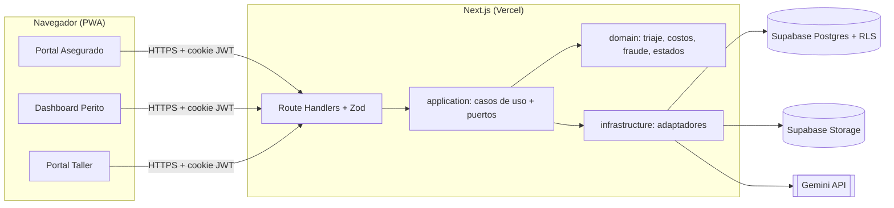

# AutoDamage AI — Guía de construcción para agentes de IA

> Documento de instrucciones para agentes de IA que construyen el proyecto. Está organizado por sprints. Cada sprint es **autocontenido**: incluye la arquitectura, las herramientas, los datos, los contratos, las tareas y las pruebas que necesitas.

---

## 0. Cómo usar este documento

1. El usuario te dirá qué sprint trabajar (ejemplo: "vamos a trabajar el Sprint 2").
2. Lee la **sección 1 (Reglas globales)** y **solo la sección del sprint indicado**. No necesitas leer los demás sprints.
3. Antes de escribir código, verifica los **Prerrequisitos** del sprint (lista de archivos/funcionalidades que ya deben existir). Si falta algo, **detente y avísalo** en lugar de improvisarlo.
4. Implementa **únicamente** las tareas del sprint. Lo listado en "Fuera de alcance" no se toca.
5. Las tareas llevan una etiqueta de rol por si el usuario te pide trabajar solo una parte: `[PM]` gestión/documentación, `[BE]` backend e IA, `[FE]` frontend, `[QA]` pruebas y datos. Si el usuario no especifica rol, hazlas todas.
6. Termina siempre ejecutando los **Comandos de verificación** y entrega un reporte con: criterios de aceptación cumplidos (✔/✘), resultado de las pruebas y archivos creados o modificados.
7. Si una decisión no está especificada, elige la opción más simple coherente con las reglas globales y regístrala en `docs/adr/NNNN-titulo.md` (formato: contexto, decisión, consecuencias).

---

## 1. Reglas globales (leer siempre)

### 1.1 Producto

**AutoDamage AI** es una PWA de triaje inteligente de siniestros vehiculares leves y moderados.

Flujo: el asegurado captura fotos en vivo con la cámara → el sistema aplica controles anti-fraude → una IA multimodal (Gemini) detecta piezas dañadas y severidad → el backend calcula el costo con un baremo y aplica reglas de triaje → asigna una ruta:

| Ruta        | Significado                                        | Estado del siniestro                  | Qué ocurre                                    |
| ----------- | -------------------------------------------------- | ------------------------------------- | --------------------------------------------- |
| 🟢 VERDE    | Daño leve, costo < 500 USD, sin indicios de fraude | `FAST_TRACK`                          | Se emite una orden de trabajo automáticamente |
| 🟡 AMARILLA | Daño moderado o caso dudoso                        | `EN_REVISION`                         | Un perito revisa y decide                     |
| 🔴 ROJA     | Pérdida total, daño estructural, airbags o fraude  | `EN_REVISION` + inspección presencial | Se bloquea la resolución automática           |

**Principio Human-in-the-Loop:** el sistema **nunca** rechaza un siniestro de forma automática. Solo un usuario con rol `PERITO` puede registrar el dictamen `RECHAZADO`.

**Actores:** `ASEGURADO` (móvil), `PERITO` (dashboard), `TALLER` (portal de órdenes), `ADMIN` (consulta y auditoría).

### 1.2 Stack (todo gratuito)

| Capa                  | Tecnología                                                                                                                                                |
| --------------------- | --------------------------------------------------------------------------------------------------------------------------------------------------------- |
| Lenguaje              | **TypeScript** en modo `strict` (todo el proyecto)                                                                                                        |
| Runtime               | Node.js LTS vigente                                                                                                                                       |
| Framework             | **Next.js** (App Router) + React; frontend y API en el mismo proyecto (Route Handlers). Versión estable más reciente al iniciar, fijada en `package.json` |
| Estilos / UI          | Tailwind CSS + shadcn/ui                                                                                                                                  |
| Validación            | **Zod** (en todos los bordes: entrada de API, salida de IA, variables de entorno)                                                                         |
| BD                    | **PostgreSQL en Supabase** con migraciones SQL (Supabase CLI) y **RLS**                                                                                   |
| Auth                  | **Supabase Auth** (emite JWT) con `@supabase/ssr` para cookies en Next.js                                                                                 |
| Almacenamiento        | **Supabase Storage**, bucket privado `evidencias`                                                                                                         |
| IA                    | **Google Gemini API** vía Google AI Studio, SDK `@google/genai` (nivel gratuito)                                                                          |
| Cámara                | `navigator.mediaDevices.getUserMedia` + `<canvas>`                                                                                                        |
| Difuminado de rostros | `@mediapipe/tasks-vision` (FaceDetector) en el navegador                                                                                                  |
| Mapa                  | `leaflet` + `react-leaflet` + OpenStreetMap                                                                                                               |
| Imagen en servidor    | `sharp` (hash perceptual) y `exifr` (lectura de EXIF)                                                                                                     |
| PDF (opcional)        | `pdf-lib`                                                                                                                                                 |
| Pruebas               | **Vitest** (unitarias/integración), **React Testing Library** + `jsdom`, **MSW**, **Playwright** (E2E)                                                    |
| Calidad               | ESLint, Prettier, Husky + lint-staged                                                                                                                     |
| CI/CD                 | GitHub Actions; despliegue en Vercel                                                                                                                      |
| Gestión               | GitHub Projects (tablero), Figma (wireframes), Draw.io (diagramas)                                                                                        |

### 1.3 Arquitectura

**Monolito modular en capas con puertos y adaptadores (hexagonal ligera).** Regla de dependencias (obligatoria, verificable con ESLint `no-restricted-imports`):

```
app/ (rutas, páginas)  ──►  application/ (casos de uso)  ──►  domain/ (lógica pura)
                                   │
                                   ▼
                         infrastructure/ (implementa los puertos: Supabase, Gemini, Storage)
```

- `domain/` **no importa nada** de `application/`, `infrastructure/`, `app/`, React, Next, Supabase ni de ninguna librería con efectos secundarios. Solo TypeScript puro.
- `application/` define los **puertos** (interfaces) y orquesta casos de uso usando el dominio. No conoce Supabase ni Gemini concretos.
- `infrastructure/` implementa los puertos. Es el único lugar donde se importan `@supabase/*`, `@google/genai`, `sharp`, `exifr`.
- `app/` (Route Handlers y páginas) valida entradas con Zod, resuelve dependencias en `src/composition.ts` y llama a los casos de uso.
- **Composition root:** `src/composition.ts` instancia los adaptadores según `AI_PROVIDER` (`gemini` | `mock`) y exporta los casos de uso listos.



### 1.4 Paradigmas y patrones (aplicar de forma consistente)

- **Funcional en `domain/`:** funciones puras, datos inmutables (`readonly`, `as const`), sin `Date.now()` ni `Math.random()` internos (recibir el "ahora" como parámetro), sin I/O.
- **OOP ligera en infraestructura:** clases que implementan interfaces (puertos) con dependencias inyectadas por constructor.
- **Strategy:** `AiProvider` con `GeminiProvider` y `MockProvider`.
- **Repository:** `ClaimRepository`, `WorkOrderRepository`, `AuditRepository`, `BaremoRepository` con implementación Supabase e `InMemory*` para pruebas.
- **State machine:** transiciones de siniestro y de orden de trabajo como funciones puras que rechazan transiciones inválidas.
- **DTO + validación en el borde:** ningún dato externo entra al dominio sin pasar por un esquema Zod.
- **Componentes React declarativos**, lógica de UI en hooks, sin lógica de negocio en componentes.

### 1.5 Convenciones de código

- TypeScript `strict: true`; prohibido `any` (usar `unknown` + Zod); prohibido `// @ts-ignore`.
- Alias de importación `@/` → `src/`.
- Nombres: archivos en `kebab-case`; tipos/clases `PascalCase`; funciones/variables `camelCase`; constantes `UPPER_SNAKE_CASE`.
- **BD en español `snake_case`** (ej. `nivel_severidad`). El dominio usa `camelCase` en español para términos de negocio (ej. `costoTotalUsd`). Los repositorios mapean entre ambos (`toDomain` / `toRow`).
- Errores: clase `AppError { code: string; message: string; status: number; details?: unknown }`. Respuesta de error de API siempre `{ "error": { "code", "message", "details?" } }`.
- Dinero: USD, redondeo a 2 decimales con helper `roundMoney` (`Math.round(x * 100) / 100`).
- Fechas: ISO 8601 en UTC en APIs y BD (`timestamptz`).
- Pruebas: archivo `*.test.ts(x)` junto al código; descripciones en español ("debería ..."); usar `it.each` para tablas de casos.
- Commits: Conventional Commits (`feat:`, `fix:`, `test:`, `chore:`, `docs:`). Ramas: `feature/<tema>`. Todo cambio entra por PR a `main`.
- **Seguridad:** secretos solo en variables de entorno; `SUPABASE_SERVICE_ROLE_KEY` y `GEMINI_API_KEY` solo en servidor (nunca con prefijo `NEXT_PUBLIC_`); toda ruta de API verifica sesión y rol; nunca confiar en datos del cliente.
- **Las pruebas unitarias son parte de cada tarea.** Una tarea sin pruebas no está terminada. La CI **nunca** llama a la API real de Gemini.

### 1.6 Variables de entorno

```
NEXT_PUBLIC_SUPABASE_URL=
NEXT_PUBLIC_SUPABASE_ANON_KEY=
SUPABASE_SERVICE_ROLE_KEY=        # solo servidor
GEMINI_API_KEY=                   # solo servidor
GEMINI_MODEL=                     # modelo Flash-Lite vigente en el free tier; nunca escrito en duro
AI_PROVIDER=gemini                # gemini | mock
DAILY_AI_QUOTA_LIMIT=200          # tope interno de análisis por día
AI_MAX_RPM=10                     # tope interno de análisis por minuto (por instancia)
```

Validar todas con Zod en `src/lib/env.ts` (falla al arrancar si falta alguna requerida). Mantener `.env.example` actualizado.

### 1.7 Glosario de dominio (tipos compartidos)

```ts
type Rol = 'ASEGURADO' | 'PERITO' | 'TALLER' | 'ADMIN';
type Severidad = 'LEVE' | 'MODERADO' | 'SEVERO';
type Accion = 'REPARAR' | 'PINTAR' | 'SUSTITUIR';
type Ruta = 'VERDE' | 'AMARILLA' | 'ROJA';
type EstadoSiniestro =
  'PENDIENTE' | 'FAST_TRACK' | 'EN_REVISION' | 'APROBADO' | 'RECHAZADO' | 'FINALIZADO';
type EstadoAnalisis = 'NO_INICIADO' | 'EN_PROCESO' | 'COMPLETADO' | 'FALLIDO';
type TipoInspeccion = 'DIGITAL_IA' | 'PRESENCIAL';
type DictamenFinal = 'APROBADO' | 'RECHAZADO' | 'AMPLIACION_REQUERIDA';
type VerdictFraude =
  | 'SIN_RIESGO'
  | 'SOSPECHA_RECAPTURA'
  | 'INCONSISTENCIA_GPS'
  | 'INCONSISTENCIA_TEMPORAL'
  | 'FOTO_DUPLICADA';
type EstadoOrden = 'EMITIDA' | 'RECIBIDO' | 'EN_REPARACION' | 'COMPLETADO';
type Etiqueta =
  'IA_NO_DISPONIBLE' | 'SIN_PIEZAS_VALIDAS' | 'BAJA_CONFIANZA' | 'CODIGOS_DESCONOCIDOS';
```

### 1.8 Estructura de carpetas objetivo (proyecto terminado)

```
autodamage-ai/
├── AGENTS.md
├── README.md
├── .env.example
├── package.json · tsconfig.json · eslint.config.mjs · vitest.config.ts · playwright.config.ts
├── next.config.ts · tailwind.config.ts · components.json
├── public/
│   ├── manifest.webmanifest · icons/
│   └── mediapipe/                      # wasm + modelo del FaceDetector (autohospedados)
├── src/
│   ├── middleware.ts                   # sesión y redirección por rol (o proxy.ts según la versión de Next)
│   ├── composition.ts                  # composition root
│   ├── app/
│   │   ├── (auth)/login · registro
│   │   ├── (asegurado)/asegurado/      # nuevo-siniestro · siniestros · siniestros/[id]
│   │   ├── (perito)/perito/            # bandeja · siniestros/[id]
│   │   ├── (taller)/taller/            # ordenes · ordenes/[id]
│   │   └── api/
│   │       ├── health/route.ts
│   │       ├── vehiculos/route.ts
│   │       ├── siniestros/route.ts
│   │       ├── siniestros/[id]/route.ts
│   │       ├── siniestros/[id]/imagenes/route.ts
│   │       ├── siniestros/[id]/analizar/route.ts
│   │       ├── siniestros/[id]/dictamen/route.ts
│   │       ├── siniestros/[id]/reanalizar/route.ts
│   │       ├── siniestros/[id]/auditoria/route.ts
│   │       ├── siniestros/[id]/reporte/route.ts      # PDF (opcional)
│   │       └── ordenes/route.ts · ordenes/[id]/estado/route.ts
│   ├── domain/
│   │   ├── config.ts                   # umbrales y constantes
│   │   ├── types.ts                    # tipos del glosario
│   │   ├── triage/ (triage.ts, triage.test.ts)
│   │   ├── cost/ (cost.ts, cost.test.ts)
│   │   ├── fraud/ (geo.ts, hash.ts, verdict.ts + tests)
│   │   ├── claim-state/ (claim-state.ts, work-order-state.ts + tests)
│   │   └── workshop/ (assign-workshop.ts + test)
│   ├── application/
│   │   ├── ports/ (ai-provider.ts, claim-repository.ts, work-order-repository.ts,
│   │   │          audit-repository.ts, baremo-repository.ts, storage-service.ts, clock.ts)
│   │   └── use-cases/ (create-claim, upload-image, analyze-claim, issue-verdict,
│   │                   update-work-order, list-claims, get-claim, ...)
│   ├── infrastructure/
│   │   ├── supabase/ (server-client.ts, admin-client.ts, browser-client.ts, database.types.ts)
│   │   ├── repositories/ (supabase-*.ts, in-memory-*.ts)
│   │   ├── ai/ (gemini-provider.ts, mock-provider.ts, prompt-v1.ts, ai-schema.ts)
│   │   ├── storage/ (supabase-storage.ts)
│   │   └── image/ (dhash.ts, exif.ts)
│   ├── components/ (ui/ shadcn, claim/, camera/, perito/, taller/)
│   ├── hooks/ · lib/ (env.ts, errors.ts, api-client.ts, format.ts)
├── supabase/
│   ├── config.toml · migrations/
│   └── seed/baremo.json
├── scripts/ (seed-baremo.ts, seed-dev-users.ts, evaluar-ia.ts)
├── tests/ (e2e/, fixtures/ai-responses/, validation/)
├── docs/ (adr/, cuotas-ia.md, plan-de-pruebas.md, prompts/)
└── .github/ (workflows/ci.yml, keep-alive.yml · CODEOWNERS · pull_request_template.md)
```

### 1.9 Definition of Done (aplica a toda tarea)

- Código en PR revisado, sin errores de ESLint ni de TypeScript.
- Pruebas unitarias nuevas, CI en verde, cobertura de `src/domain/` ≥ 90 % y global ≥ 70 %.
- Sin secretos en el repositorio; `.env.example` actualizado.
- Criterios de aceptación de la tarea verificados.
- Documentación (README/ADR) actualizada si cambió una decisión.

---

## SPRINT 1 — Fundaciones, base de datos y autenticación

**Duración:** 2 semanas · **Objetivo:** esqueleto desplegado con CI, base de datos completa con RLS, login por roles y baremo cargado.

### Prerrequisitos

Repositorio vacío en GitHub, cuenta de Supabase (crear 2 proyectos: `dev` y `prod`), cuenta de Vercel conectada al repo y una API key de Google AI Studio.

### Contexto técnico de este sprint

- **Herramientas a instalar:** `next`, `react`, `typescript`, `tailwindcss`, shadcn/ui, `zod`, `@supabase/supabase-js`, `@supabase/ssr`, `vitest`, `@vitest/coverage-v8`, `jsdom`, `@testing-library/react`, `@testing-library/jest-dom`, `@playwright/test`, `eslint`, `prettier`, `husky`, `lint-staged`, `supabase` (CLI, como devDependency), `tsx` (para scripts).
- **Arquitectura aplicable:** crear el esqueleto de carpetas de la sección 1.8 (carpetas vacías con `.gitkeep` donde aún no hay código) y la regla de dependencias con ESLint.
- **Auth:** el registro público crea **solo** usuarios `ASEGURADO`. `PERITO`, `TALLER` y `ADMIN` se crean únicamente con el script `seed-dev-users.ts`. Un trigger en BD crea la fila de `usuarios` cuando se inserta un usuario en `auth.users`, forzando `rol = 'ASEGURADO'` (ignorar cualquier rol enviado en metadatos del registro).

### Esquema de base de datos (migraciones completas de este sprint)

Crear migraciones versionadas en `supabase/migrations/`. Convenciones: PK `UUID DEFAULT gen_random_uuid()` (excepto `baremo_mock`, `SERIAL`); fechas `TIMESTAMPTZ DEFAULT now()`.

```sql
-- usuarios (id = auth.users.id)
CREATE TABLE usuarios (
  id UUID PRIMARY KEY REFERENCES auth.users(id) ON DELETE CASCADE,
  nombre_completo VARCHAR(150) NOT NULL,
  email VARCHAR(150) UNIQUE NOT NULL,
  rol VARCHAR(20) NOT NULL CHECK (rol IN ('ASEGURADO','PERITO','TALLER','ADMIN')),
  creado_en TIMESTAMPTZ DEFAULT now()
);

CREATE TABLE vehiculos (
  id UUID PRIMARY KEY DEFAULT gen_random_uuid(),
  asegurado_id UUID NOT NULL REFERENCES usuarios(id) ON DELETE CASCADE,
  matricula VARCHAR(20) UNIQUE NOT NULL,
  marca VARCHAR(50) NOT NULL,
  modelo VARCHAR(50) NOT NULL,
  numero_poliza VARCHAR(50) UNIQUE NOT NULL
);

CREATE TABLE peritos (
  id UUID PRIMARY KEY DEFAULT gen_random_uuid(),
  usuario_id UUID UNIQUE NOT NULL REFERENCES usuarios(id) ON DELETE CASCADE,
  numero_licencia VARCHAR(50) UNIQUE NOT NULL,
  especialidad VARCHAR(100) DEFAULT 'Vehiculos Livianos',
  estado VARCHAR(20) DEFAULT 'ACTIVO' CHECK (estado IN ('ACTIVO','OCUPADO','INACTIVO'))
);

CREATE TABLE talleres (
  id UUID PRIMARY KEY DEFAULT gen_random_uuid(),
  usuario_id UUID UNIQUE NOT NULL REFERENCES usuarios(id) ON DELETE CASCADE,
  nombre VARCHAR(150) NOT NULL,
  direccion TEXT,
  telefono VARCHAR(30),
  activo BOOLEAN DEFAULT TRUE
);

CREATE TABLE baremo_mock (
  id SERIAL PRIMARY KEY,
  codigo_pieza VARCHAR(50) UNIQUE NOT NULL,
  pieza_nombre VARCHAR(100) NOT NULL,
  marca_vehiculo VARCHAR(50) NOT NULL DEFAULT 'GENERICO',
  costo_repuesto_base NUMERIC(10,2) NOT NULL CHECK (costo_repuesto_base >= 0),
  horas_mano_obra NUMERIC(4,2) NOT NULL CHECK (horas_mano_obra >= 0),
  costo_hora_mo NUMERIC(10,2) NOT NULL DEFAULT 30.00
);

CREATE TABLE siniestros (
  id UUID PRIMARY KEY DEFAULT gen_random_uuid(),
  asegurado_id UUID NOT NULL REFERENCES usuarios(id),
  vehiculo_id UUID NOT NULL REFERENCES vehiculos(id),
  fecha_registro TIMESTAMPTZ DEFAULT now(),
  fecha_incidente TIMESTAMPTZ NOT NULL,
  latitud NUMERIC(10,8) NOT NULL,
  longitud NUMERIC(11,8) NOT NULL,
  descripcion TEXT,
  estado VARCHAR(30) NOT NULL DEFAULT 'PENDIENTE'
    CHECK (estado IN ('PENDIENTE','FAST_TRACK','EN_REVISION','APROBADO','RECHAZADO','FINALIZADO')),
  ruta VARCHAR(10) CHECK (ruta IN ('VERDE','AMARILLA','ROJA')),
  analisis_estado VARCHAR(15) NOT NULL DEFAULT 'NO_INICIADO'
    CHECK (analisis_estado IN ('NO_INICIADO','EN_PROCESO','COMPLETADO','FALLIDO')),
  requiere_inspeccion_presencial BOOLEAN NOT NULL DEFAULT FALSE,
  etiquetas TEXT[] NOT NULL DEFAULT '{}'
);

CREATE TABLE imagenes_siniestro (
  id UUID PRIMARY KEY DEFAULT gen_random_uuid(),
  siniestro_id UUID NOT NULL REFERENCES siniestros(id) ON DELETE CASCADE,
  storage_path TEXT NOT NULL,
  hash_perceptual CHAR(16) NOT NULL,          -- dHash de 64 bits en hexadecimal
  capturada_en TIMESTAMPTZ NOT NULL,
  latitud NUMERIC(10,8),
  longitud NUMERIC(11,8),
  precision_gps_m NUMERIC(8,2),
  user_agent TEXT,
  orden SMALLINT NOT NULL DEFAULT 0,
  rostros_difuminados BOOLEAN NOT NULL DEFAULT FALSE,
  creado_en TIMESTAMPTZ DEFAULT now()
);

CREATE TABLE inspecciones_periciales (
  id UUID PRIMARY KEY DEFAULT gen_random_uuid(),
  siniestro_id UUID NOT NULL REFERENCES siniestros(id) ON DELETE CASCADE,
  perito_id UUID REFERENCES peritos(id),
  fecha_inspeccion TIMESTAMPTZ DEFAULT now(),
  tipo_inspeccion VARCHAR(30) NOT NULL DEFAULT 'DIGITAL_IA'
    CHECK (tipo_inspeccion IN ('DIGITAL_IA','PRESENCIAL')),
  kilometraje INT,
  observaciones_perito TEXT,
  dictamen_final VARCHAR(30) CHECK (dictamen_final IN ('APROBADO','RECHAZADO','AMPLIACION_REQUERIDA')),
  verdict_fraude VARCHAR(30) NOT NULL DEFAULT 'SIN_RIESGO'
    CHECK (verdict_fraude IN ('SIN_RIESGO','SOSPECHA_RECAPTURA','INCONSISTENCIA_GPS',
                              'INCONSISTENCIA_TEMPORAL','FOTO_DUPLICADA')),
  indicadores_fraude TEXT[] NOT NULL DEFAULT '{}',
  nivel_severidad VARCHAR(10) CHECK (nivel_severidad IN ('LEVE','MODERADO','SEVERO')),
  costo_total_estimado NUMERIC(10,2),
  confianza_global NUMERIC(4,3),
  modelo_ia VARCHAR(80),
  version_prompt VARCHAR(20),
  respuesta_ia JSONB
);

CREATE TABLE evaluacion_detallada_danos (
  id UUID PRIMARY KEY DEFAULT gen_random_uuid(),
  inspeccion_id UUID NOT NULL REFERENCES inspecciones_periciales(id) ON DELETE CASCADE,
  codigo_pieza VARCHAR(50) NOT NULL REFERENCES baremo_mock(codigo_pieza),
  accion_requerida VARCHAR(20) NOT NULL CHECK (accion_requerida IN ('REPARAR','PINTAR','SUSTITUIR')),
  horas_mano_obra NUMERIC(4,2) NOT NULL,
  costo_pieza_estimado NUMERIC(10,2) NOT NULL,
  confianza NUMERIC(4,3),
  imagen_id UUID REFERENCES imagenes_siniestro(id),
  bbox JSONB,                                   -- [ymin,xmin,ymax,xmax] normalizado 0-1000
  aprobado_por_perito BOOLEAN NOT NULL DEFAULT TRUE,
  observacion_pieza TEXT
);

CREATE TABLE ordenes_trabajo (
  id UUID PRIMARY KEY DEFAULT gen_random_uuid(),
  siniestro_id UUID UNIQUE NOT NULL REFERENCES siniestros(id) ON DELETE CASCADE,
  taller_id UUID NOT NULL REFERENCES talleres(id),
  estado VARCHAR(20) NOT NULL DEFAULT 'EMITIDA'
    CHECK (estado IN ('EMITIDA','RECIBIDO','EN_REPARACION','COMPLETADO')),
  monto_autorizado NUMERIC(10,2) NOT NULL,
  creado_en TIMESTAMPTZ DEFAULT now(),
  actualizado_en TIMESTAMPTZ DEFAULT now()
);

CREATE TABLE audit_log (
  id UUID PRIMARY KEY DEFAULT gen_random_uuid(),
  entidad VARCHAR(40) NOT NULL,
  entidad_id UUID NOT NULL,
  accion VARCHAR(60) NOT NULL,
  actor_tipo VARCHAR(10) NOT NULL CHECK (actor_tipo IN ('USUARIO','SISTEMA','IA')),
  actor_id UUID,
  datos JSONB,
  creado_en TIMESTAMPTZ DEFAULT now()
);
-- audit_log es inmutable: sin políticas UPDATE/DELETE y con trigger BEFORE UPDATE OR DELETE que lance excepción.
CREATE INDEX ON siniestros (asegurado_id);
CREATE INDEX ON siniestros (estado, ruta);
CREATE INDEX ON imagenes_siniestro (siniestro_id);
CREATE INDEX ON imagenes_siniestro (hash_perceptual);
CREATE INDEX ON audit_log (entidad, entidad_id);
```

### Políticas RLS (activar RLS en **todas** las tablas)

Crear función auxiliar `public.rol_actual()` (`SECURITY DEFINER`, lee `usuarios.rol` donde `id = auth.uid()`).

| Tabla                                                                         | ASEGURADO                  | PERITO               | TALLER                                   | ADMIN        |
| ----------------------------------------------------------------------------- | -------------------------- | -------------------- | ---------------------------------------- | ------------ |
| `usuarios`                                                                    | SELECT/UPDATE de su fila   | SELECT de su fila    | SELECT de su fila                        | SELECT todas |
| `vehiculos`                                                                   | CRUD de los suyos          | SELECT               | —                                        | SELECT       |
| `siniestros`                                                                  | SELECT/INSERT de los suyos | SELECT todos; UPDATE | SELECT solo los vinculados a sus órdenes | SELECT todos |
| `imagenes_siniestro`, `inspecciones_periciales`, `evaluacion_detallada_danos` | SELECT de sus siniestros   | SELECT/INSERT/UPDATE | SELECT de imágenes de sus órdenes        | SELECT       |
| `ordenes_trabajo`                                                             | SELECT de sus siniestros   | SELECT               | SELECT/UPDATE de las suyas               | SELECT       |
| `baremo_mock`                                                                 | SELECT                     | SELECT               | SELECT                                   | SELECT       |
| `audit_log`                                                                   | —                          | SELECT               | —                                        | SELECT       |

Las escrituras del sistema (análisis de IA, auditoría, creación de órdenes) se hacen con el cliente `admin` (service role) desde el servidor, nunca desde el navegador.

### Baremo (fuente única: `supabase/seed/baremo.json`)

20 piezas, `marca_vehiculo = "GENERICO"`, `costo_hora_mo = 30.00`. Formato: `{codigo_pieza, pieza_nombre, costo_repuesto_base, horas_mano_obra}`.

| codigo_pieza        | repuesto USD | horas MO |
| ------------------- | -----------: | -------: |
| PARAGOLPES_DEL      |          180 |      2.5 |
| PARAGOLPES_TRA      |          170 |      2.5 |
| FARO_DEL_IZQ        |          120 |      1.0 |
| FARO_DEL_DER        |          120 |      1.0 |
| FARO_TRA_IZQ        |           70 |      0.8 |
| FARO_TRA_DER        |           70 |      0.8 |
| CAPO                |          260 |      3.0 |
| GUARDABARRO_DEL_IZQ |          140 |      2.0 |
| GUARDABARRO_DEL_DER |          140 |      2.0 |
| PUERTA_DEL_IZQ      |          300 |      3.5 |
| PUERTA_DEL_DER      |          300 |      3.5 |
| PUERTA_TRA_IZQ      |          280 |      3.5 |
| PUERTA_TRA_DER      |          280 |      3.5 |
| PARABRISAS          |          220 |      2.0 |
| LUNETA_TRA          |          160 |      2.0 |
| ESPEJO_IZQ          |           60 |      0.5 |
| ESPEJO_DER          |           60 |      0.5 |
| PORTON_MALETERO     |          290 |      3.0 |
| PARRILLA            |           55 |      0.7 |
| TAPA_COMBUSTIBLE    |           25 |      0.4 |

(`pieza_nombre` legible en español, ej. "Faro delantero izquierdo".)

### Tareas

- **[PM]** Crear tablero en GitHub Projects con columnas `Backlog / Sprint / En progreso / Revisión / Hecho`; plantilla de PR (`.github/pull_request_template.md`) con checklist de la DoD; archivo `CODEOWNERS`; `docs/plan-de-pruebas.md` con la matriz RF → caso de prueba (CP01–CP06 vacíos por completar).
- **[BE]** Inicializar proyecto Next.js + TypeScript estricto + Tailwind + shadcn/ui; ESLint con la regla de dependencias entre capas; Prettier, Husky y lint-staged.
- **[BE]** `supabase init`; escribir las migraciones del esquema, el trigger de alta de `usuarios`, la función `rol_actual()`, las políticas RLS y el trigger de inmutabilidad de `audit_log`. Aplicar a `dev`. Generar tipos con `supabase gen types typescript` a `src/infrastructure/supabase/database.types.ts`.
- **[BE]** `src/lib/env.ts` (Zod), `src/lib/errors.ts` (`AppError`), clientes de Supabase (`server-client.ts`, `browser-client.ts`, `admin-client.ts`).
- **[BE]** Script `scripts/seed-baremo.ts` (upsert desde `baremo.json`) y `scripts/seed-dev-users.ts` (crea 1 ASEGURADO, 1 PERITO con fila en `peritos`, 2 TALLERES con fila en `talleres` y 1 ADMIN; contraseñas desde variable de entorno).
- **[BE]** `GET /api/health`: ejecuta `SELECT 1` en la BD y devuelve `{status:"ok", db:"ok", time}`.
- **[BE]** Workflow `.github/workflows/ci.yml` (en cada PR: `npm ci`, lint, typecheck, tests con cobertura, build) y `.github/workflows/keep-alive.yml` (`cron` cada 3 días que llama a `/api/health` del entorno desplegado, más `workflow_dispatch`).
- **[BE]** Configurar despliegue en Vercel con variables de entorno de `prod`; incluir `docs/cuotas-ia.md` con las cuotas reales de Gemini leídas en AI Studio (RPM/RPD del modelo elegido) y el valor de `GEMINI_MODEL`.
- **[FE]** `middleware.ts`: refresca sesión, protege rutas por grupo y redirige según rol (`ASEGURADO → /asegurado`, `PERITO → /perito`, `TALLER → /taller`, `ADMIN → /perito`).
- **[FE]** Páginas `login` y `registro` (formularios con validación Zod), layout por portal con navegación y botón de cerrar sesión, páginas "hola" de cada portal.
- **[FE]** PWA: `manifest.webmanifest` (nombre, iconos 192/512, `display: standalone`, `theme_color`), meta viewport; el service worker se difiere (no obligatorio en este sprint).
- **[FE]** Wireframes mobile-first en Figma de los 3 portales (enlace guardado en `docs/diseno.md`).
- **[QA]** Configurar `vitest.config.ts` (entorno `node` para dominio y `jsdom` para componentes, umbrales de cobertura: `src/domain/**` ≥ 90 %, global ≥ 70 %) y `playwright.config.ts` (proyectos móvil y escritorio). Añadir scripts npm: `test`, `test:coverage`, `test:e2e`, `lint`, `typecheck`.

### Pruebas unitarias requeridas

- `env.test.ts`: falla con variable faltante; acepta configuración válida; `AI_PROVIDER` solo admite `gemini|mock`.
- Esquemas Zod de registro/login (`email` inválido, contraseña corta, campos vacíos) y de vehículo.
- `baremo-seed.test.ts`: `baremo.json` tiene exactamente 20 elementos, `codigo_pieza` únicos, valores no negativos, horas > 0.
- `errors.test.ts`: `AppError` serializa al formato `{error:{code,message}}`.
- (Integración, contra proyecto `dev`) prueba RLS: un asegurado no puede leer siniestros de otro; un taller no puede leer `inspecciones_periciales`; `audit_log` rechaza UPDATE/DELETE.

### Criterios de aceptación

- [ ] `npm run lint && npm run typecheck && npm run test && npm run build` pasan sin errores.
- [ ] La CI está en verde en un PR de prueba.
- [ ] Las 11 tablas existen con RLS activo; el baremo tiene 20 filas.
- [ ] Un usuario nuevo registrado desde la web queda con rol `ASEGURADO` aunque intente enviar otro rol.
- [ ] Cada rol del seed inicia sesión y es redirigido a su portal; un asegurado que abre `/perito` es redirigido.
- [ ] La app está desplegada en Vercel y `/api/health` responde `ok`.

### Comandos de verificación

```bash
npm run lint && npm run typecheck && npm run test:coverage && npm run build
npx supabase db push        # aplica migraciones a dev
npx tsx scripts/seed-baremo.ts && npx tsx scripts/seed-dev-users.ts
```

### Fuera de alcance

Lógica de triaje, integración con Gemini, subida de imágenes, cámara, dashboards funcionales.

---

## SPRINT 2 — Dominio, IA y API del siniestro

**Duración:** 2 semanas · **Objetivo:** el "cerebro" funciona de punta a punta por API (sin interfaz final): crear siniestro, subir imágenes, analizar con IA, calcular costo, aplicar triaje y persistir.

### Prerrequisitos

Sprint 1 completo: proyecto Next.js con CI, 11 tablas con RLS, baremo cargado, clientes Supabase, `env.ts`, `AppError`, usuarios de prueba.

### Contexto técnico de este sprint

- **Librerías nuevas:** `@google/genai`, `sharp`, `exifr`, `msw` (devDependency).
- **Capas que se construyen:** `domain/` (triaje, costos, fraude, estados), `application/ports` + `use-cases`, `infrastructure/ai`, `infrastructure/repositories`, `infrastructure/image`, `infrastructure/storage`, y los Route Handlers.
- **Tablas que usa este sprint:**
  - `siniestros(id, asegurado_id, vehiculo_id, fecha_incidente, latitud, longitud, descripcion, estado, ruta, analisis_estado, requiere_inspeccion_presencial, etiquetas[])`
  - `imagenes_siniestro(id, siniestro_id, storage_path, hash_perceptual, capturada_en, latitud, longitud, precision_gps_m, user_agent, orden, rostros_difuminados)`
  - `inspecciones_periciales(id, siniestro_id, tipo_inspeccion, verdict_fraude, indicadores_fraude[], nivel_severidad, costo_total_estimado, confianza_global, modelo_ia, version_prompt, respuesta_ia)`
  - `evaluacion_detallada_danos(id, inspeccion_id, codigo_pieza, accion_requerida, horas_mano_obra, costo_pieza_estimado, confianza, imagen_id, bbox)`
  - `baremo_mock(codigo_pieza, costo_repuesto_base, horas_mano_obra, costo_hora_mo)` · `audit_log(entidad, entidad_id, accion, actor_tipo, actor_id, datos)`
- **Storage:** bucket privado `evidencias`; ruta `{siniestro_id}/{imagen_id}.jpg`. Solo el servidor sube y genera URLs firmadas (60 min).

### Constantes (`src/domain/config.ts`)

```ts
export const COSTO_LIMITE_VERDE_USD = 500; // costo debe ser ESTRICTAMENTE menor
export const CONFIANZA_MINIMA = 0.6; // por debajo → ruta AMARILLA
export const GPS_DISTANCIA_MAX_M = 500; // se usa max(500, precision_gps_m)
export const EDAD_MAX_CAPTURA_MIN = 15; // captura vs. momento de recepción en servidor
export const HAMMING_MAX_DUPLICADO = 5; // bits de 64
export const FACTOR_PINTURA = 0.6; // fracción de horas de MO para PINTAR
export const MAX_IMAGENES = 5;
export const MAX_BYTES_IMAGEN = 1_500_000;
```

### Reglas de negocio a implementar (funciones puras en `domain/`)

**Costo de una pieza** (`cost.ts`, redondeo con `roundMoney`):

- `SUSTITUIR` = `costo_repuesto_base + horas_mano_obra × costo_hora_mo`
- `REPARAR` = `horas_mano_obra × costo_hora_mo`
- `PINTAR` = `horas_mano_obra × FACTOR_PINTURA × costo_hora_mo`
- `costoTotal` = suma de las piezas. Las piezas con `codigo_pieza` que no exista en el baremo se descartan y se añade la etiqueta `CODIGOS_DESCONOCIDOS`; si no queda ninguna pieza válida → etiqueta `SIN_PIEZAS_VALIDAS`.

**Triaje** (`triage.ts`). Firma:

```ts
type TriageInput = {
  severidad: Severidad;
  estructurales: { danoEstructural: boolean; airbags: boolean; perdidaTotal: boolean };
  costoTotalUsd: number;
  verdictFraude: VerdictFraude;
  confianzaGlobal: number;
  iaDisponible: boolean;
  piezasValidas: number;
};
type TriageResult = {
  ruta: Ruta;
  estado: 'FAST_TRACK' | 'EN_REVISION';
  tipoInspeccion: TipoInspeccion;
  requiereInspeccionPresencial: boolean;
  etiquetas: Etiqueta[];
  razones: string[]; // explicación legible de la decisión
};
function triage(input: TriageInput): TriageResult;
```

Orden de evaluación (la primera regla que aplique gana):

1. **ROJA** si `danoEstructural || airbags || perdidaTotal || severidad === 'SEVERO' || verdictFraude !== 'SIN_RIESGO'` → `estado: EN_REVISION`, `requiereInspeccionPresencial: true`, `tipoInspeccion: PRESENCIAL`.
2. **AMARILLA** si `!iaDisponible` (etiqueta `IA_NO_DISPONIBLE`), o `piezasValidas === 0` (etiqueta `SIN_PIEZAS_VALIDAS`), o `confianzaGlobal < CONFIANZA_MINIMA` (etiqueta `BAJA_CONFIANZA`), o `severidad === 'MODERADO'`.
3. **VERDE** si `severidad === 'LEVE' && costoTotalUsd < 500 && verdictFraude === 'SIN_RIESGO'` → `FAST_TRACK`.
4. **AMARILLA** en cualquier otro caso (ante la duda decide un humano).

**Veredicto de fraude** (`fraud/verdict.ts`): recibe las banderas calculadas y devuelve `{verdict, indicadores[]}`. Prioridad cuando hay varias: `SOSPECHA_RECAPTURA` > `FOTO_DUPLICADA` > `INCONSISTENCIA_GPS` > `INCONSISTENCIA_TEMPORAL` > `SIN_RIESGO`. `indicadores` lista todas las que apliquen.

- `geo.ts`: `haversineMeters(a, b)`; inconsistencia GPS si la distancia entre el GPS de cualquier imagen y la ubicación declarada del siniestro supera `max(GPS_DISTANCIA_MAX_M, precision_gps_m)`.
- Inconsistencia temporal si `recibidaEn − capturadaEn` supera `EDAD_MAX_CAPTURA_MIN` minutos o la captura es posterior a la recepción (+1 min de tolerancia de reloj).
- `hash.ts`: `hammingDistanceHex(a, b)` sobre hashes de 16 caracteres hexadecimales; duplicado si distancia ≤ `HAMMING_MAX_DUPLICADO`.

**Máquina de estados del siniestro** (`claim-state.ts`): transiciones permitidas `PENDIENTE → FAST_TRACK | EN_REVISION`; `EN_REVISION → APROBADO | RECHAZADO | EN_REVISION` (ampliación); `FAST_TRACK → FINALIZADO`; `APROBADO → FINALIZADO`. **`RECHAZADO` solo si el actor es `PERITO` y el dictamen es `RECHAZADO`**; cualquier intento automático lanza `AppError('RECHAZO_AUTOMATICO_PROHIBIDO', 409)`.

### Contrato con la IA

**Puerto** (`application/ports/ai-provider.ts`):

```ts
interface AiProvider {
  analizarDanos(input: {
    imagenes: { base64: string; mimeType: 'image/jpeg' }[];
    codigosPiezasValidos: string[];
    contextoVehiculo?: { marca?: string; modelo?: string };
  }): Promise<AiAnalysis>; // lanza AiUnavailableError | AiInvalidResponseError
}
```

**Esquema de salida** (`infrastructure/ai/ai-schema.ts`, Zod, y el mismo esquema JSON se envía a Gemini como `responseSchema`):

```json
{
  "vehiculo": { "marca": "string|null", "modelo": "string|null" },
  "piezas_detectadas": [
    { "codigo_pieza": "string (debe pertenecer a la lista de códigos válidos)",
      "accion": "REPARAR|PINTAR|SUSTITUIR",
      "confianza": 0.0,
      "imagen_indice": 0,
      "bbox": [ymin, xmin, ymax, xmax] }
  ],
  "nivel_severidad": "LEVE|MODERADO|SEVERO",
  "indicadores_estructurales": { "dano_estructural": false, "airbags": false, "perdida_total": false },
  "sospecha_recaptura": false,
  "motivo_recaptura": "string|null",
  "confianza_global": 0.0
}
```

`bbox` está normalizado de 0 a 1000 (convención de Gemini: `[ymin, xmin, ymax, xmax]`); `confianza` y `confianza_global` entre 0 y 1; `imagen_indice` es el índice de la imagen enviada.

**`GeminiProvider`** (`infrastructure/ai/gemini-provider.ts`):

- Usa `@google/genai`: `ai.models.generateContent({ model: env.GEMINI_MODEL, contents: [{ role: 'user', parts: [...imágenes como inlineData, { text: prompt }] }], config: { responseMimeType: 'application/json', responseSchema, temperature: 0 } })`.
- Envía **todas las imágenes del siniestro en una sola solicitud**.
- Valida la respuesta con Zod. Si el JSON es inválido o hay error 5xx: **un** reintento. Si falla de nuevo → `AiInvalidResponseError`/`AiUnavailableError`.
- Error 429 o cuota agotada: **sin reintento** → `AiUnavailableError('CUOTA_AGOTADA')`.
- Timeout con `AbortSignal` (25 s).
- `MockProvider`: devuelve respuestas de `tests/fixtures/ai-responses/*.json` según un escenario configurable (`leve-faro`, `moderado-puerta`, `severo-estructural`, `recaptura`, `baja-confianza`, `sin-piezas`, `json-invalido`, `cuota-agotada`).

**Prompt v1** (`infrastructure/ai/prompt-v1.ts`, copia en `docs/prompts/v1.md`, constante `VERSION_PROMPT = 'v1'`). Debe contener, en español: (a) rol: perito automotriz que analiza fotos de un siniestro; (b) instrucción de usar **solo** los códigos de la lista inyectada; (c) definición de severidad (LEVE: daño estético localizado; MODERADO: varias piezas o daño que afecta funcionalidad; SEVERO: deformación estructural, airbags desplegados o pérdida total); (d) instrucción de marcar `sospecha_recaptura` si ve patrones de moiré, bordes de pantalla, reflejos de monitor o baja nitidez típica de foto a pantalla; (e) pedir `bbox` normalizado 0–1000; (f) no inventar: si no se ve la pieza, no incluirla; (g) responder únicamente con el JSON del esquema; (h) **nunca estimar precios** (el costo lo calcula el sistema).

### Endpoints de este sprint

| Método y ruta                                | Rol                    | Entrada                                                                                                                                 | Salida                                                     |
| -------------------------------------------- | ---------------------- | --------------------------------------------------------------------------------------------------------------------------------------- | ---------------------------------------------------------- |
| `POST /api/vehiculos` · `GET /api/vehiculos` | ASEGURADO              | `{matricula, marca, modelo, numero_poliza}`                                                                                             | vehículo / lista                                           |
| `POST /api/siniestros`                       | ASEGURADO              | `{vehiculo_id, descripcion, latitud, longitud, fecha_incidente}`                                                                        | `201 {id, estado:"PENDIENTE"}`                             |
| `POST /api/siniestros/:id/imagenes`          | ASEGURADO (dueño)      | `multipart/form-data`: `file` (JPEG ≤ 1.5 MB), `capturada_en`, `latitud`, `longitud`, `precision_gps_m`, `orden`, `rostros_difuminados` | `201 {imagen_id}`                                          |
| `POST /api/siniestros/:id/analizar`          | ASEGURADO (dueño)      | — (requiere ≥ 1 imagen)                                                                                                                 | `202 {analisis_estado:"EN_PROCESO"}`                       |
| `GET /api/siniestros/:id`                    | dueño / PERITO / ADMIN | —                                                                                                                                       | siniestro + imágenes (URLs firmadas) + inspección + piezas |

- **Subida de imagen:** validar tipo MIME `image/jpeg`, tamaño, máximo `MAX_IMAGENES` por siniestro y que el siniestro pertenezca al usuario. Con `exifr` leer EXIF: si contiene `Make`, `Model` o `DateTimeOriginal` (señal de archivo de galería/cámara y no de captura en canvas) → rechazar con `422 ARCHIVO_NO_EN_VIVO`. Calcular el dHash (`sharp`: escala de grises, 9×8, comparar píxeles adyacentes → 64 bits → 16 hex) y guardarlo.
- **Analizar:** responde `202` de inmediato y ejecuta el proceso con `after()` de `next/server` (Next.js ≥ 15.1); `export const maxDuration = 60`. Marca `analisis_estado = EN_PROCESO`.
- **Caso de uso `analyzeClaim`** (orden exacto): (1) comprobar cuota diaria (contar inspecciones `DIGITAL_IA` de hoy ≥ `DAILY_AI_QUOTA_LIMIT`) y límite por minuto → si se excede, no llamar a la IA y tratar como `iaDisponible=false`; (2) calcular banderas de fraude deterministas (GPS, tiempo, duplicados contra hashes de otros siniestros); (3) llamar a `AiProvider`; (4) filtrar piezas fuera del baremo; (5) calcular costos; (6) combinar `sospecha_recaptura` con las demás banderas en `verdict_fraude`; (7) `triage()`; (8) en una transacción lógica: crear `inspecciones_periciales` (con `respuesta_ia`, `modelo_ia`, `version_prompt`), insertar `evaluacion_detallada_danos`, actualizar `siniestros` (`estado`, `ruta`, `etiquetas`, `requiere_inspeccion_presencial`, `analisis_estado = COMPLETADO`); (9) registrar en `audit_log` con `actor_tipo = 'IA'` (resultado del análisis) y `'SISTEMA'` (decisión de triaje). Ante cualquier fallo inesperado: `analisis_estado = FALLIDO` y auditoría del error.
- En este sprint **no se crea aún la orden de trabajo** (Sprint 4); la ruta VERDE solo deja el siniestro en `FAST_TRACK`.

### Tareas

- **[BE]** Implementar `domain/` completo descrito arriba con sus pruebas.
- **[BE]** Definir los puertos y casos de uso: `createClaim`, `uploadImage`, `analyzeClaim`, `getClaim`.
- **[BE]** Implementar repositorios Supabase + `InMemory*`, `SupabaseStorageService`, `dhash.ts`, `exif.ts`.
- **[BE]** Implementar `GeminiProvider`, `MockProvider`, esquema Zod, prompt v1; selector por `AI_PROVIDER` en `composition.ts`.
- **[BE]** Implementar los Route Handlers listados con validación Zod, verificación de sesión y rol, y formato de error estándar.
- **[BE]** Limitador por minuto (token bucket en memoria, `AI_MAX_RPM`) y contador diario por consulta a BD.
- **[FE]** `lib/api-client.ts` tipado (fetch + manejo de errores del formato estándar); componentes base: `RouteBadge` (verde/amarillo/rojo con texto accesible, no solo color), `ClaimCard`, `LoadingState`, `ErrorState`; pantalla provisional de formulario de siniestro (campos de texto, sin cámara aún).
- **[QA]** Crear fixtures de respuestas de IA en `tests/fixtures/ai-responses/`; revisar la tabla de casos del triaje; reunir y etiquetar las primeras **60 fotos** del set de validación en `tests/validation/etiquetas.csv` (columnas: `archivo,severidad,piezas,es_recaptura`, piezas separadas por `|`, doble etiquetado).
- **[PM]** Documentar el contrato de la API en `docs/api.md` (tabla de endpoints, códigos de error).

### Pruebas unitarias requeridas

- **`triage.test.ts`** (`it.each`, mínimo 20 casos), incluyendo:

| Caso                                     | Resultado esperado              |
| ---------------------------------------- | ------------------------------- |
| LEVE, 150 USD, sin fraude, confianza 0.9 | VERDE / FAST_TRACK              |
| LEVE, 499.99 USD                         | VERDE                           |
| LEVE, 500.00 USD                         | AMARILLA                        |
| MODERADO, 80 USD                         | AMARILLA                        |
| SEVERO                                   | ROJA, presencial                |
| LEVE + `airbags`                         | ROJA                            |
| LEVE + `SOSPECHA_RECAPTURA`              | ROJA                            |
| LEVE + `FOTO_DUPLICADA`                  | ROJA                            |
| LEVE, confianza 0.59                     | AMARILLA + `BAJA_CONFIANZA`     |
| `iaDisponible=false`                     | AMARILLA + `IA_NO_DISPONIBLE`   |
| 0 piezas válidas                         | AMARILLA + `SIN_PIEZAS_VALIDAS` |
| Ninguna combinación produce `RECHAZADO`  | verificado                      |

- `cost.test.ts`: cada acción; redondeo; suma; descarte de códigos desconocidos; ejemplo `FARO_DEL_IZQ` + `SUSTITUIR` = 150.00.
- `geo.test.ts`: Haversine con distancias conocidas; umbral con y sin `precision_gps_m`.
- `hash.test.ts`: distancia Hamming (0, 1, 64 bits); límite exacto en 5.
- `verdict.test.ts`: prioridad entre veredictos, lista de indicadores, inconsistencia temporal (captura vieja, captura futura).
- `claim-state.test.ts`: transiciones válidas e inválidas; rechazo automático prohibido.
- `ai-schema.test.ts`: acepta fixtures válidos; rechaza severidad inválida, `confianza > 1`, `bbox` con 3 valores.
- `gemini-provider.test.ts` (con MSW o cliente simulado): éxito; JSON inválido con reintento exitoso; JSON inválido dos veces; 429 sin reintento; timeout.
- `analyze-claim.test.ts` (con `InMemory*` y `MockProvider`): flujo verde, amarillo, rojo por recaptura, cuota agotada, fallo inesperado → `FALLIDO`.
- `upload-image.test.ts`: rechaza EXIF de cámara (`ARCHIVO_NO_EN_VIVO`), tamaño excedido, MIME inválido, más de 5 imágenes, siniestro ajeno.

### Criterios de aceptación

- [ ] Con `AI_PROVIDER=mock`, un cliente HTTP (Bruno/Postman o Playwright API) completa: crear vehículo → crear siniestro → subir imagen → analizar → consultar y ve ruta, piezas y costo.
- [ ] Con `AI_PROVIDER=gemini` y una clave real, un análisis manual de una foto de prueba devuelve un JSON válido (verificación manual única, no automatizada).
- [ ] Si la IA falla o la cuota se agota, el siniestro termina en `EN_REVISION`/AMARILLA con etiqueta `IA_NO_DISPONIBLE`.
- [ ] Una imagen con EXIF de cámara es rechazada.
- [ ] Cobertura de `src/domain/` ≥ 90 %.
- [ ] Un asegurado no puede consultar ni analizar siniestros ajenos.

### Comandos de verificación

```bash
npm run lint && npm run typecheck && npm run test:coverage && npm run build
AI_PROVIDER=mock npm run dev   # y probar el flujo con Bruno/Postman
```

### Fuera de alcance

Cámara y difuminado de rostros, dashboard del perito, dictamen, órdenes de trabajo, portal del taller, PDF.

---

## SPRINT 3 — Portal del asegurado y dashboard del perito

**Duración:** 2 semanas · **Objetivo:** un asegurado reporta un siniestro desde el celular con captura en vivo y el perito revisa y dictamina.

### Prerrequisitos

Sprint 2 completo: dominio (triaje, costo, fraude, estados), casos de uso `createClaim/uploadImage/analyzeClaim/getClaim`, endpoints de vehículos/siniestros/imágenes/analizar, `GeminiProvider` y `MockProvider`, `RouteBadge`, `ClaimCard`, `api-client`.

### Contexto técnico de este sprint

- **Librerías nuevas:** `@mediapipe/tasks-vision`, `leaflet`, `react-leaflet`, `@types/leaflet`.
- **Capas:** principalmente `app/` (páginas), `components/`, `hooks/`; en backend, nuevos casos de uso `listClaims` y `issueVerdict` y el endpoint de dictamen.
- **Tablas que usa:** `siniestros`, `imagenes_siniestro`, `inspecciones_periciales(perito_id, dictamen_final, observaciones_perito, kilometraje)`, `evaluacion_detallada_danos(aprobado_por_perito, observacion_pieza, accion_requerida, costo_pieza_estimado, bbox, imagen_id)`, `peritos(id, usuario_id)`, `audit_log`.
- **Cámara:** solo se permite captura con `getUserMedia({ video: { facingMode: 'environment' } })`. **Prohibido** usar `<input type="file">` o selector de galería en el flujo de captura.
- **Mediapipe:** autohospedar los archivos wasm y el modelo `blaze_face_short_range.tflite` en `public/mediapipe/`. Política **fail-closed**: si el detector no carga, no se permite enviar la foto y se muestra un mensaje con opción de reintentar.
- **Carga de Leaflet:** componente cliente con `dynamic(() => import(...), { ssr: false })`.

### Pipeline de captura en el navegador (en este orden)

1. Mostrar `<video>` con la cámara trasera; botón "Capturar" (requiere gesto del usuario, necesario en iOS/Safari).
2. Dibujar el fotograma en un `<canvas>`.
3. Ejecutar el FaceDetector sobre el canvas y **difuminar/pixelar** cada rostro detectado (con margen del 15 %).
4. Redimensionar a máximo 1280 px por el lado largo y exportar JPEG con calidad 0.7 (`canvas.toBlob`); la salida no contiene EXIF.
5. Obtener la geolocalización (`navigator.geolocation.getCurrentPosition`, alta precisión, timeout 10 s) y `capturada_en = new Date().toISOString()`.
6. Subir con `multipart/form-data` a `POST /api/siniestros/:id/imagenes` con `rostros_difuminados = true`.

### Endpoints de este sprint (nuevos)

| Método y ruta                                       | Rol                                            | Descripción                                                                                                                                                                                                                       |
| --------------------------------------------------- | ---------------------------------------------- | --------------------------------------------------------------------------------------------------------------------------------------------------------------------------------------------------------------------------------- |
| `GET /api/siniestros?ruta=&estado=&page=&pageSize=` | ASEGURADO (los suyos) / PERITO / ADMIN (todos) | Lista paginada (tamaño por defecto 20), orden por `fecha_registro` descendente                                                                                                                                                    |
| `POST /api/siniestros/:id/dictamen`                 | PERITO                                         | Body Zod: `{dictamen_final: 'APROBADO'\|'RECHAZADO'\|'AMPLIACION_REQUERIDA', observaciones_perito, kilometraje?, ajustes?: [{evaluacion_id, accion_requerida?, costo_pieza_estimado?, aprobado_por_perito, observacion_pieza?}]}` |

**Caso de uso `issueVerdict`:** valida que el siniestro esté `EN_REVISION`; aplica los ajustes a `evaluacion_detallada_danos` y recalcula `costo_total_estimado`; actualiza `inspecciones_periciales` (`perito_id`, `dictamen_final`); usa la máquina de estados para mover el siniestro (`APROBADO`, `RECHAZADO` o permanecer en `EN_REVISION` si es ampliación); escribe en `audit_log` (`actor_tipo = 'USUARIO'`, con los valores anterior y nuevo). En este sprint, aprobar **no** crea aún la orden de trabajo.

### Pantallas

**Portal del asegurado (móvil primero)**

- `/asegurado/nuevo-siniestro`: asistente en pasos → (1) elegir o registrar vehículo, (2) descripción, fecha y hora del incidente y ubicación (geolocalización con confirmación en mapa), (3) captura guiada de 3 a 5 fotos con miniaturas y opción de repetir cada una, (4) revisión y envío. Al enviar: crear siniestro → subir imágenes → llamar a `analizar`.
- `/asegurado/siniestros/[id]`: estado del análisis con _polling_ cada 3 s (máximo 2 min, luego mensaje "seguimos procesando"), resultado con `RouteBadge`, piezas detectadas y monto estimado, y mensaje claro del siguiente paso según la ruta.
- `/asegurado/siniestros`: lista de sus siniestros.

**Dashboard del perito (escritorio/tablet)**

- `/perito`: bandeja con filtros por ruta y estado, orden por antigüedad, indicador de etiquetas (`IA_NO_DISPONIBLE`, `BAJA_CONFIANZA`…).
- `/perito/siniestros/[id]`: visor de imágenes con cajas (SVG superpuesto, coordenadas 0–1000 escaladas al tamaño mostrado, etiqueta con nombre de pieza y confianza); tabla editable de piezas (acción, costo, aprobar/desaprobar); datos del veredicto de fraude y razones del triaje; mapa Leaflet con la ubicación declarada y las de las fotos; formulario de dictamen (aprobar / ajustar / rechazar / solicitar ampliación) con observaciones obligatorias en rechazo.

### Tareas

- **[BE]** Casos de uso `listClaims` e `issueVerdict`, endpoints `GET /api/siniestros` y `POST /api/siniestros/:id/dictamen`, con verificación de rol y paginación. Registrar auditoría del dictamen.
- **[BE]** Ajustar el prompt (versión `v1.1` si hay cambios) usando los primeros resultados sobre las 60 fotos etiquetadas; guardar `VERSION_PROMPT` actualizada y el historial en `docs/prompts/`.
- **[FE]** Hook `useCamera` (permisos, errores, cierre del stream), componente `CameraCapture`, módulo `faceBlur.ts` (carga única del detector, procesamiento por lote), módulo `compressImage.ts`, hook `useGeolocation`.
- **[FE]** Asistente de nuevo siniestro, pantalla de resultado con _polling_ (hook `usePolling`), lista del asegurado.
- **[FE]** Bandeja del perito, detalle con `DamageViewer` (cajas SVG), `PartsTable` editable, `VerdictForm`, `ClaimMap`.
- **[FE]** Estados vacíos, de carga y de error en todas las pantallas; accesibilidad básica (etiquetas, foco, contraste, no depender solo del color).
- **[QA]** Pruebas de componentes y primeros E2E con Playwright en móvil emulado (cámara falsa de Chromium con `--use-fake-device-for-media-stream --use-fake-ui-for-media-stream`, geolocalización simulada) usando `AI_PROVIDER=mock`.
- **[QA]** **CP01**: intentar subir un archivo con EXIF de cámara vía API y comprobar el rechazo `ARCHIVO_NO_EN_VIVO`; verificar que la UI no ofrece selector de archivos. Primera medición de precisión con el script manual sobre el set de validación (registrar en `docs/plan-de-pruebas.md`).
- **[PM]** Medir velocidad al cierre del sprint (historias completadas vs. planificadas). Si es < 80 %, marcar como "opcionales" PDF, difuminado de matrículas y proveedor secundario de IA.

### Pruebas unitarias requeridas

- `faceBlur.test.ts`: con un detector simulado que devuelve N rostros, se invoca el difuminado N veces con el margen del 15 %; con 0 rostros no modifica el lienzo; si el detector falla, lanza el error (fail-closed).
- `compressImage.test.ts`: respeta el máximo de 1280 px conservando la proporción y devuelve `image/jpeg`.
- `useCamera.test.tsx`: manejo de permiso denegado, ausencia de cámara, y que se detienen las pistas al desmontar.
- `usePolling.test.tsx` (timers simulados): se detiene al llegar a `COMPLETADO`/`FALLIDO` y al superar el tiempo máximo.
- `CameraCapture.test.tsx`: no existe ningún `input[type=file]` en el árbol.
- `DamageViewer.test.tsx`: convierte coordenadas 0–1000 a píxeles correctamente para distintos tamaños de contenedor.
- `PartsTable.test.tsx` y `VerdictForm.test.tsx`: validación (observaciones obligatorias al rechazar), recálculo del total.
- `issue-verdict.test.ts` (con `InMemory*`): aprobar, ajustar costos, rechazar, ampliación; un PERITO no puede dictaminar un siniestro que no esté `EN_REVISION`; auditoría escrita; un ASEGURADO recibe 403.
- `list-claims.test.ts`: el asegurado solo ve los suyos; filtros por ruta y estado; paginación.

### Criterios de aceptación

- [ ] Desde un teléfono real: registrar un siniestro con 3 fotos tomadas en vivo y ver el resultado de la ruta.
- [ ] Ninguna foto con rostros nítidos sale del navegador (verificado visualmente y por la prueba de difuminado).
- [ ] El perito ve la bandeja, abre un caso amarillo, ajusta una pieza, aprueba, y el estado pasa a `APROBADO` con auditoría registrada.
- [ ] El perito puede rechazar solo con observaciones, y esa es la única vía a `RECHAZADO`.
- [ ] Los E2E del flujo asegurado → perito pasan en CI con proveedor `mock`.
- [ ] Cobertura de `domain/` ≥ 90 %.

### Comandos de verificación

```bash
npm run lint && npm run typecheck && npm run test:coverage && npm run build
AI_PROVIDER=mock npm run test:e2e
```

### Fuera de alcance

Órdenes de trabajo y portal del taller, detección de fotos duplicadas en producción (el cálculo ya existe desde el Sprint 2), PDF, reanálisis.

---

## SPRINT 4 — Taller, órdenes de trabajo, anti-fraude y trazabilidad

**Duración:** 2 semanas · **Objetivo:** cerrar el ciclo completo (ruta verde → orden → taller → finalizado) y reforzar anti-fraude, auditoría y tolerancia a cuota agotada.

### Prerrequisitos

Sprint 3 completo: flujo asegurado y perito funcionando, `issueVerdict`, `listClaims`, `DamageViewer`, E2E con mock, `triage`, `claim-state`, `analyzeClaim` con banderas de fraude, `audit_log` en uso.

### Contexto técnico de este sprint

- **Librerías nuevas:** `pdf-lib` (solo si se aborda el PDF opcional).
- **Capas:** `domain/workshop` y `domain/claim-state/work-order-state.ts` (puro), casos de uso `issueWorkOrder`, `updateWorkOrder`, `reanalyzeClaim`, repositorios `WorkOrderRepository`, portal del taller en `app/(taller)`.
- **Tablas que usa:**
  - `ordenes_trabajo(id, siniestro_id UNIQUE, taller_id, estado, monto_autorizado, creado_en, actualizado_en)`
  - `talleres(id, usuario_id, nombre, direccion, telefono, activo)`
  - `siniestros(estado, ruta, etiquetas[], analisis_estado)` · `inspecciones_periciales(costo_total_estimado, verdict_fraude, indicadores_fraude[])` · `evaluacion_detallada_danos` · `imagenes_siniestro` · `audit_log`

### Reglas de negocio de este sprint

**Estados de la orden** (`work-order-state.ts`, función pura): `EMITIDA → RECIBIDO → EN_REPARACION → COMPLETADO`. Solo avanza un paso a la vez y nunca retrocede. Solo el taller dueño de la orden puede cambiar su estado. Al pasar a `COMPLETADO`, el siniestro pasa a `FINALIZADO` (vía la máquina de estados del siniestro, desde `FAST_TRACK` o `APROBADO`).

**Creación de la orden** (`issueWorkOrder`): se ejecuta (a) automáticamente al terminar `analyzeClaim` con ruta **VERDE**, y (b) al aprobar un perito un siniestro (`dictamen_final = APROBADO`). Pasos: elegir taller con `assignWorkshop`, crear la orden con `monto_autorizado = costo_total_estimado`, mover el siniestro (`APROBADO` en el caso (b)), y auditar. Debe ser **idempotente**: si ya existe orden para el siniestro, no crea otra (restricción `UNIQUE` y comprobación previa).

**Asignación de taller** (`assign-workshop.ts`, pura): entre talleres con `activo = true`, elegir el de menor número de órdenes abiertas (`EMITIDA`, `RECIBIDO`, `EN_REPARACION`); empate → el que tenga la orden abierta más antigua, o el de menor `id` si ninguno tiene órdenes. Sin talleres activos → `AppError('SIN_TALLERES_DISPONIBLES', 409)` y el siniestro queda `EN_REVISION` con auditoría.

**Anti-fraude reforzado:** la comparación de `hash_perceptual` contra imágenes de **otros** siniestros usa la distancia de Hamming ≤ `HAMMING_MAX_DUPLICADO`; las imágenes del mismo siniestro no se comparan entre sí. Si hay duplicado, `verdict_fraude = FOTO_DUPLICADA` y el caso se vuelve ROJA. Se suma la señal `sospecha_recaptura` de la IA y las banderas de GPS y de tiempo (ya existentes).

**Tolerancia a cuota agotada:** si el análisis se degradó con `IA_NO_DISPONIBLE`, el perito puede pulsar "Reintentar análisis" (`POST /api/siniestros/:id/reanalizar`, rol PERITO, permitido solo si la etiqueta existe o `analisis_estado = FALLIDO`). El reanálisis crea una nueva inspección `DIGITAL_IA`, conserva las anteriores para auditoría y respeta los límites de cuota.

### Endpoints de este sprint (nuevos)

| Método y ruta                                  | Rol                                 | Descripción                                                                      |
| ---------------------------------------------- | ----------------------------------- | -------------------------------------------------------------------------------- |
| `GET /api/ordenes?estado=`                     | TALLER (las suyas) / PERITO / ADMIN | Lista de órdenes con datos del vehículo, piezas aprobadas y monto                |
| `PATCH /api/ordenes/:id/estado`                | TALLER (dueño)                      | Body `{estado: 'RECIBIDO'\|'EN_REPARACION'\|'COMPLETADO'}`; valida la transición |
| `POST /api/siniestros/:id/reanalizar`          | PERITO                              | Reintenta el análisis de IA                                                      |
| `GET /api/siniestros/:id/auditoria`            | PERITO / ADMIN                      | Lista cronológica de `audit_log` del siniestro y su orden                        |
| `GET /api/siniestros/:id/reporte` _(opcional)_ | dueño / PERITO / ADMIN              | PDF con evidencias, dictamen, piezas y presupuesto (`pdf-lib`)                   |

Al asegurado se le muestra el avance de la orden en `/asegurado/siniestros/[id]` (estado de la reparación en solo lectura).

### Tareas

- **[BE]** `assignWorkshop`, `work-order-state`, casos de uso `issueWorkOrder` (idempotente), `updateWorkOrder`, `reanalyzeClaim`; integrar `issueWorkOrder` en `analyzeClaim` (ruta verde) y en `issueVerdict` (aprobación).
- **[BE]** Endpoints `GET/PATCH` de órdenes, `reanalizar`, `auditoria`; auditoría en cada transición y decisión (actor, valor anterior y nuevo).
- **[BE]** Revisar la lógica de fraude con las imágenes de otros siniestros (consulta por `hash_perceptual`) y asegurar que el reanálisis recalcula banderas.
- **[BE]** _(Opcional)_ `GET /api/siniestros/:id/reporte` con `pdf-lib`; _(opcional)_ proveedor de IA secundario implementando `AiProvider` (cadena de respaldo en `composition.ts`: primario → secundario → degradación).
- **[FE]** Portal del taller: `/taller/ordenes` (lista con filtros por estado) y `/taller/ordenes/[id]` (datos del vehículo, piezas aprobadas, monto, imágenes con URL firmada, botón de siguiente estado con confirmación).
- **[FE]** Perito: pestaña de historial de auditoría en el detalle, botón "Reintentar análisis" visible solo si aplica, aviso de la etiqueta `IA_NO_DISPONIBLE`; asegurado: tarjeta de avance de reparación.
- **[FE]** _(Opcional)_ botón "Descargar PDF".
- **[QA]** E2E completos: (a) ruta verde: asegurado → orden automática → taller avanza estados → siniestro `FINALIZADO`; (b) ruta roja por recaptura simulada; (c) ruta amarilla aprobada por perito → orden; (d) cuota agotada → perito reanaliza. Casos **CP02, CP03, CP05**.
- **[QA]** Pruebas de RLS adicionales (un taller no ve órdenes de otro taller; un asegurado no ve órdenes ajenas). Segunda medición de precisión de la IA con el set de validación (≥ 60 fotos).
- **[PM]** _Feature freeze_ al final del sprint. Registrar riesgos abiertos y avanzar el capítulo de pruebas del informe.

### Pruebas unitarias requeridas

- `assign-workshop.test.ts`: menor carga gana; empate por orden más antigua; sin órdenes → menor `id`; sin talleres activos → error; ignora talleres inactivos.
- `work-order-state.test.ts`: cada transición válida; saltar un paso, retroceder o repetir → error.
- `issue-work-order.test.ts`: crea orden en VERDE y tras aprobar; **idempotencia** (doble ejecución = una orden); `monto_autorizado` igual al costo; auditoría escrita; sin talleres → error y el siniestro queda `EN_REVISION`.
- `update-work-order.test.ts`: solo el taller dueño puede avanzar; al completar, el siniestro pasa a `FINALIZADO`; un PERITO/ASEGURADO recibe 403.
- `analyze-claim.test.ts` (ampliado): foto duplicada de otro siniestro → ROJA con `FOTO_DUPLICADA`; no compara contra el mismo siniestro; recaptura de la IA → ROJA.
- `reanalyze-claim.test.ts`: solo con etiqueta `IA_NO_DISPONIBLE` o `FALLIDO`; conserva inspecciones previas; respeta cuota.
- `audit.test.ts`: cada decisión (IA, sistema, perito, taller) deja un registro con actor correcto; el registro no se puede modificar.
- `OrderStatusButton.test.tsx` y `AuditTimeline.test.tsx` (componentes).
- _(Si se hace el PDF)_ `report.test.ts`: genera un PDF no vacío con el título y el número de piezas esperado.

### Criterios de aceptación

- [ ] Flujo verde de punta a punta sin intervención humana hasta el taller; el taller completa y el siniestro queda `FINALIZADO`.
- [ ] Una foto repetida en dos siniestros distintos marca el segundo como ROJO con `FOTO_DUPLICADA`.
- [ ] Con cuota agotada simulada el flujo no se bloquea; el perito reanaliza con éxito después.
- [ ] Toda decisión automática o manual aparece en la auditoría con actor, momento y datos.
- [ ] Un taller solo ve y modifica sus propias órdenes (comprobado por prueba de RLS).
- [ ] E2E (a)–(d) en verde en CI con `AI_PROVIDER=mock`.

### Comandos de verificación

```bash
npm run lint && npm run typecheck && npm run test:coverage && npm run build
AI_PROVIDER=mock npm run test:e2e
```

### Fuera de alcance

Nuevas funcionalidades tras el _feature freeze_, difuminado de matrículas (solo si queda tiempo en el Sprint 5 y está aprobado por el usuario).

---

## SPRINT 5 — Validación, endurecimiento y entrega

**Duración:** 2 semanas · **Objetivo:** versión 1.0 estable, medida, segura y documentada. **No se añaden funcionalidades nuevas**; solo correcciones, calidad y documentación.

### Prerrequisitos

Sprint 4 completo: flujo completo funcionando en el entorno desplegado, auditoría, órdenes, E2E en verde.

### Contexto técnico de este sprint

- **Herramientas nuevas (opcionales):** `@lhci/cli` (Lighthouse CI), `@next/bundle-analyzer`.
- **Arquitectura:** sin cambios estructurales. Cualquier modificación debe ser un _bugfix_ o una mejora de rendimiento/seguridad con su prueba.
- **Set de validación:** `tests/validation/etiquetas.csv` (columnas `archivo,severidad,piezas,es_recaptura`, piezas con `|` como separador) con 60–100 fotos en `tests/validation/imagenes/` (no versionar imágenes con datos personales).

### Script de evaluación de la IA (`scripts/evaluar-ia.ts`)

Ejecuta cada foto (o grupo de fotos del mismo caso) contra `GeminiProvider` real, respetando los límites de cuota (espaciar llamadas según `AI_MAX_RPM`), y genera `docs/informe-validacion.md` con:

- **Concordancia de severidad** (aciertos / total) y matriz de confusión LEVE/MODERADO/SEVERO.
- **Piezas:** precisión, exhaustividad (recall) y F1 comparando el conjunto de códigos detectados con el etiquetado.
- **Detección de recaptura:** verdaderos/falsos positivos y negativos.
- **Distribución de rutas** (porcentaje VERDE/AMARILLA/ROJA).
- **Latencia** p50 y p95 por análisis (objetivo: < 10 s).
- Registro del modelo (`GEMINI_MODEL`), `VERSION_PROMPT` y la fecha de ejecución.
  Si la cuota impide completar el set en un día, el script debe guardar el progreso y poder reanudarse.

### Tareas

- **[QA]** Regresión completa; ejecutar y documentar **CP01–CP06** en `docs/plan-de-pruebas.md` con evidencia:
  - CP01: carga de archivo/galería bloqueada (UI y API).
  - CP02: foto de una pantalla con un choque → ruta ROJA (usar fotos reales del set marcadas `es_recaptura`).
  - CP03: faro roto con metadatos válidos y costo < 500 → VERDE y orden creada.
  - CP04: flujo end-to-end en el entorno desplegado desde un teléfono real.
  - CP05: CRUD de usuarios/vehículos/siniestros y flujo de estados de las órdenes.
  - CP06: tiempos de carga, adaptabilidad móvil de la cámara y análisis < 10 s (medido).
- **[QA]** Pruebas manuales en dispositivos reales (≥ 1 iOS y ≥ 2 Android distintos): cámara, GPS, difuminado, rendimiento; checklist firmada en `docs/plan-de-pruebas.md`. Cada bug corregido añade una prueba de regresión.
- **[QA]** Completar el set de validación (60–100 fotos, doble etiquetado) y ejecutar `scripts/evaluar-ia.ts`; documentar resultados.
- **[BE]** Revisión de seguridad con esta lista: (1) ningún secreto en el repositorio ni en el bundle del cliente; (2) toda ruta de API verifica sesión y rol; (3) RLS probada para cada rol/tabla; (4) validación Zod en todas las entradas; (5) límites de tamaño y tipo de archivo; (6) cabeceras HTTP de seguridad en `next.config.ts` (`Content-Security-Policy` compatible con Leaflet/OSM, Mediapipe y Supabase, `X-Content-Type-Options`, `Referrer-Policy`, `Permissions-Policy` con cámara y geolocalización solo para el propio origen); (7) los errores no filtran información interna; (8) URLs firmadas con expiración corta.
- **[BE]** Optimizar latencia del análisis (reducir tamaño de imagen enviada si es necesario, evitar consultas redundantes); desplegar a `prod`; verificar migraciones, variables de entorno y el _keep-alive_.
- **[FE]** Pulido de UX; auditoría Lighthouse en móvil (objetivos: Rendimiento ≥ 80, Accesibilidad ≥ 90, PWA instalable); corrección de problemas de accesibilidad; service worker mínimo para instalabilidad (sin cachear datos privados); revisión en Chrome, Safari y Firefox.
- **[PM]** Congelar versión (_code freeze_) el día 8 del sprint; `README.md` final (instalación, variables, scripts, despliegue); manual de usuario con capturas por rol en `docs/manual-usuario.md`; guion de demo (flujo verde, amarillo, rojo y taller) y video corto; informe final con limitaciones (cuotas de IA, privacidad de datos de prueba, uso no comercial del hosting, difuminado de matrículas pendiente, controles anti-fraude a nivel API no infalibles); retrospectiva global.

### Pruebas unitarias requeridas

- Una prueba de regresión por cada bug corregido en el sprint (nombre: `regresion-<id-bug>`).
- Cierre de huecos de cobertura: reporte con `src/domain/**` ≥ 90 % y global ≥ 70 %; añadir pruebas para las ramas no cubiertas más críticas (triaje, fraude, estados, permisos).
- `security-headers.test.ts`: la configuración de `next.config.ts` incluye las cabeceras esperadas.
- `evaluar-ia.test.ts`: cálculo de métricas (precisión, recall, F1, matriz de confusión, percentiles) con datos sintéticos y resultados conocidos.

### Criterios de aceptación

- [ ] CP01–CP06 ejecutados y documentados con evidencia; todos aprobados o con defectos conocidos justificados.
- [ ] `docs/informe-validacion.md` generado con métricas reales de la IA sobre el set de validación.
- [ ] Análisis p95 < 10 s en condiciones normales (o desviación documentada).
- [ ] Sin vulnerabilidades en la lista de revisión de seguridad; RLS verificada por rol.
- [ ] Lighthouse móvil cumple los objetivos o se documentan las excepciones.
- [ ] Versión 1.0 desplegada en `prod`, `/api/health` en `ok`, _keep-alive_ activo.
- [ ] Documentación final completa (README, manual, informe, ADRs, demo).

### Comandos de verificación

```bash
npm run lint && npm run typecheck && npm run test:coverage && npm run build
AI_PROVIDER=mock npm run test:e2e
npx tsx scripts/evaluar-ia.ts      # usa la API real de Gemini; ejecutar manualmente y respetando cuotas
npx lhci autorun                   # opcional
```

### Fuera de alcance

Cualquier funcionalidad nueva; difuminado de matrículas; integraciones con sistemas externos; pagos.
