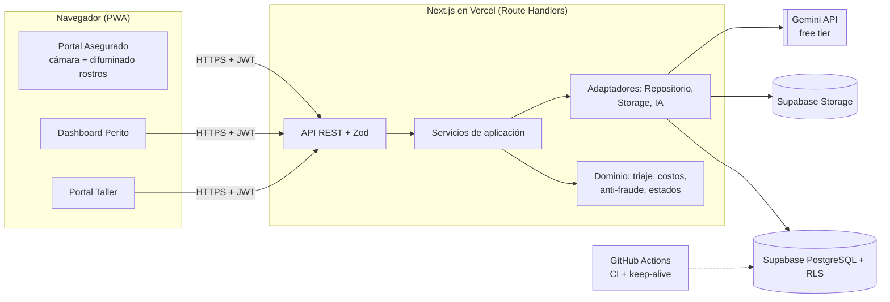

> Estado de preparación (20/10/2026): Sprint 1 abierto. Ver [reporte verificado](docs/preparacion-sprint-1.md) y [pasos de despliegue](docs/despliegue.md). No se han aplicado migraciones ni publicado esta preparación.

# AutoDamage AI — Plan de ejecución del MVP (costo $0)

Plataforma web (PWA) de triaje inteligente de siniestros vehiculares: el asegurado captura fotos en vivo, una IA multimodal detecta piezas dañadas y severidad, el backend aplica reglas de negocio para asignar una ruta (🟢 verde / 🟡 amarilla / 🔴 roja) y el perito y el taller continúan el flujo.

Este README **aterriza el documento del proyecto integrador a un MVP alcanzable por un equipo de 4 personas en 10 semanas, usando únicamente servicios y herramientas gratuitas**.

---

## 1. Qué cambió respecto al documento original

El documento tiene una base sólida, pero la sección 3 (presupuesto) contradice la cláusula de "todo gratis" y hay algunos puntos técnicos que no funcionan tal como están escritos. Estas son las decisiones tomadas:

| #   | Tema                        | Documento original                                                                                   | Decisión en este plan                                                                                                                                                                                                                                           | Por qué                                                                                                                                                 |
| --- | --------------------------- | ---------------------------------------------------------------------------------------------------- | --------------------------------------------------------------------------------------------------------------------------------------------------------------------------------------------------------------------------------------------------------------- | ------------------------------------------------------------------------------------------------------------------------------------------------------- |
| 1   | Costos                      | Hardware $5,600, Copilot Business, Jira, Figma Pro, dataset $1,000, Vercel Pro, Render, Supabase Pro | **Todo $0**: equipos y teléfonos propios del equipo, GitHub Projects, Figma Starter, datasets públicos, planes gratuitos                                                                                                                                        | Cláusula de costo cero                                                                                                                                  |
| 2   | Backend                     | FastAPI **o** Node.js, desplegado en Render                                                          | **Un solo stack TypeScript**: Next.js (frontend + API Routes) en Vercel. Se elimina Render                                                                                                                                                                      | Render gratuito "duerme" tras 15 min (cold start de 30–60 s); un solo lenguaje reduce la curva de aprendizaje y el costo de coordinación                |
| 3   | Modelo de IA                | Gemini 1.5 Flash                                                                                     | **Gemini Flash-Lite vigente en Google AI Studio**, configurable por variable de entorno (`GEMINI_MODEL`)                                                                                                                                                        | 1.5 Flash fue retirado según el propio documento (sec. 3.11)                                                                                            |
| 4   | Costos calculados por la IA | La IA devuelve costo de mano de obra y repuestos                                                     | La IA **solo** devuelve piezas, acción y severidad; **el costo lo calcula el backend** consultando `baremo_mock`                                                                                                                                                | Los LLM inventan números; un cálculo determinista es explicable, auditable y testeable                                                                  |
| 5   | Captura y EXIF              | Capturar con `getUserMedia` y extraer EXIF/GPS de la imagen                                          | Con `getUserMedia` + `canvas` **la imagen resultante no trae EXIF**. Los metadatos (GPS vía Geolocation API, hora del servidor, user-agent) los **compone la app**. `exifr` se usa solo para detectar cargas de archivo (prueba CP01)                           | Es una limitación técnica real del navegador; si no se corrige, RF03 y RF04 se contradicen                                                              |
| 6   | Anti-fraude                 | Solo detección de "recaptura" por el LLM                                                             | Se añaden **controles deterministas**: distancia GPS vs. ubicación declarada (Haversine), antigüedad de la captura y **hash perceptual (dHash)** para detectar fotos repetidas entre siniestros. La señal del LLM se mantiene como apoyo, no como única barrera | Detectar moiré con un LLM es poco fiable; los controles deterministas son baratos y testeables                                                          |
| 7   | Difuminado (RF13)           | Rostros y matrículas                                                                                 | **Rostros en el navegador** con MediaPipe Face Detector (gratis, local) antes de subir la foto. **Matrículas pasan a "Could Have"**                                                                                                                             | El difuminado de placas requiere un detector específico que no cabe en 10 semanas                                                                       |
| 8   | "Máscaras" de daño          | Máscaras de segmentación                                                                             | **Bounding boxes** devueltos por Gemini, dibujados sobre la imagen                                                                                                                                                                                              | Segmentación real exige entrenar un modelo; las cajas cubren la necesidad del perito                                                                    |
| 9   | Esquema de BD               | 7 tablas; órdenes y auditoría "resueltas" con campos de estado                                       | Se añaden **4 tablas**: `imagenes_siniestro`, `ordenes_trabajo`, `talleres`, `audit_log`; y el rol `ADMIN`                                                                                                                                                      | El portal del taller necesita estados (Recibido/En Reparación/Completado) que `siniestros.estado` no tiene, y RF12/diseño de seguridad exigen auditoría |
| 10  | Auth                        | JWT propio                                                                                           | **Supabase Auth** (emite JWT) + **Row Level Security** por rol                                                                                                                                                                                                  | Menos código propio de seguridad; ya incluido en el plan gratuito                                                                                       |
| 11  | Duración                    | 4 sprints semanales (sec. 6.3) vs. 5 sprints de 2 semanas (sec. 3.1)                                 | **5 sprints de 2 semanas = 10 semanas**                                                                                                                                                                                                                         | Unifica ambas secciones; 1 semana es muy poco para entregar y probar                                                                                    |
| 12  | Regla roja vs. RN04         | RN03 dice ruta roja = `RECHAZADO`, RN04 prohíbe rechazo automático                                   | **Ruta roja = `EN_REVISION` con bandera de riesgo + inspección presencial**; `RECHAZADO` solo lo escribe un perito                                                                                                                                              | Elimina la contradicción y mantiene el Human-in-the-Loop                                                                                                |

> ⚠️ **Sobre COCOMO II (sec. 3.5.1):** con 25 KSLOC el modelo da ≈89 personas-mes; con las mismas hipótesis, un MVP de **~4 KSLOC escritas a mano** da ≈12 personas-mes (`2.94 × 4^1.09 × 0.916`), que es compatible con 4 personas × 10 semanas. Por eso el plan recorta alcance, reutiliza librerías/servicios gestionados (Supabase Auth, Storage, shadcn/ui) y deja lo demás como backlog. Debe declararse en el Capítulo III como riesgo conocido.

---

## 2. Alcance del MVP (MoSCoW)

| Prioridad                 | Requerimientos                                                                  | Notas                                                                                                      |
| ------------------------- | ------------------------------------------------------------------------------- | ---------------------------------------------------------------------------------------------------------- |
| **Must**                  | RF01–RF07, RF13 (solo rostros)                                                  | Registro/login, siniestro, captura en vivo, metadatos, análisis IA, triaje, orden de trabajo en ruta verde |
| **Should**                | RF08–RF10                                                                       | Dashboard del perito, aprobar/ajustar/rechazar, portal del taller                                          |
| **Could**                 | RF11 (PDF), RF12 ampliado, difuminado de matrículas, proveedor de IA secundario | Solo si el equipo cumple la velocidad planificada al inicio del Sprint 4                                   |
| **Won't** (fuera del MVP) | Integración con sistemas core, pagos reales, app nativa, mapas comerciales      | Igual que en el documento                                                                                  |

**Regla de corte:** al final del Sprint 3 el equipo mide su velocidad. Si completó menos del 80 % de lo planificado, los _Could_ se eliminan y los _Should_ restantes se simplifican.

---

## 3. Roles del equipo (4 mínimo)

Todo el equipo trabaja sin costo (proyecto académico). La dedicación semanal debe confirmarse al inicio; el plan asume que el equipo puede sostener el ritmo de los 5 sprints.

| Rol                                           | Nivel  | Responsabilidades principales                                                                                                                                                                                                                                     | Entregables clave                                               |
| --------------------------------------------- | ------ | ----------------------------------------------------------------------------------------------------------------------------------------------------------------------------------------------------------------------------------------------------------------- | --------------------------------------------------------------- |
| **1. Project Manager / Scrum Master**         | Mid    | Facilita las ceremonias, mantiene el tablero (GitHub Projects), gestiona el backlog y la regla de corte MoSCoW, elimina bloqueos, redacta la documentación (capítulos del informe, README, manual), coordina la demo final. También hace de _Product Owner_ proxy | Backlog priorizado, actas de sprint, burndown, informe final    |
| **2. Desarrollador Backend + IA (Tech Lead)** | Senior | Arquitectura, modelo de datos y migraciones, RLS, API Routes, integración con Gemini (prompt, esquema JSON, adaptador, límites de cuota), motor de triaje, cálculo de costos, anti-fraude, CI/CD y despliegue. Revisa los pull requests críticos                  | Esquema SQL, API, motor de triaje, adaptador de IA, pipeline CI |
| **3. Desarrollador Frontend**                 | Mid    | Wireframes en Figma, PWA, captura con cámara, difuminado de rostros, los tres portales (asegurado, perito, taller), accesibilidad y diseño móvil                                                                                                                  | UI completa, componentes reutilizables, pruebas de componentes  |
| **4. QA + Analista de Datos**                 | Junior | Plan de pruebas, casos de prueba CP01–CP06, pruebas unitarias de apoyo y E2E, construcción y etiquetado del **set de validación** (60–100 fotos), medición de precisión y latencia, pruebas en dispositivos reales                                                | Suite E2E, informe de pruebas, dataset de validación, métricas  |

**Mitigación del punto único de falla (bus factor):** el Backend Senior y el Frontend hacen _pair programming_ al menos una vez por sprint sobre el flujo crítico; el Backend documenta las decisiones en `/docs/adr/` (Architecture Decision Records); el QA conoce el despliegue.

**Dueños de código:** `CODEOWNERS` asigna revisor obligatorio por carpeta. Ningún cambio llega a `main` sin 1 aprobación y CI en verde.

---

## 4. Stack tecnológico (100 % gratuito)

### 4.1 Resumen

| Capa                           | Tecnología                                                                 | Plan / costo        | Límite a tener presente                                                                                    |
| ------------------------------ | -------------------------------------------------------------------------- | ------------------- | ---------------------------------------------------------------------------------------------------------- |
| Lenguaje                       | **TypeScript** (todo el proyecto)                                          | Gratis              | —                                                                                                          |
| Frontend                       | **Next.js** (App Router) + React + Tailwind CSS + shadcn/ui                | Gratis              | —                                                                                                          |
| PWA                            | Web App Manifest + Service Worker (`@serwist/next` o manifest manual)      | Gratis              | La cámara requiere HTTPS (Vercel lo da)                                                                    |
| Cámara                         | `navigator.mediaDevices.getUserMedia` + `canvas`                           | Nativo              | Safari iOS requiere gesto del usuario                                                                      |
| Difuminado de rostros          | `@mediapipe/tasks-vision` (Face Detector) en el navegador                  | Gratis (Apache 2.0) | Corre en el dispositivo del usuario                                                                        |
| Mapa                           | Leaflet + react-leaflet + OpenStreetMap                                    | Gratis              | Respetar la política de uso de tiles de OSM (uso ligero)                                                   |
| Backend                        | **Next.js Route Handlers** (API REST)                                      | Incluido en Vercel  | Tiempo máximo por función (configurar `maxDuration`); por eso el análisis de IA es **asíncrono** (ver 5.3) |
| Validación                     | **Zod**                                                                    | Gratis              | —                                                                                                          |
| Base de datos                  | **PostgreSQL en Supabase Free**                                            | Gratis              | 500 MB; el proyecto se **pausa tras ~7 días sin actividad**                                                |
| Acceso a datos                 | Cliente `@supabase/supabase-js` + SQL versionado (Supabase CLI migrations) | Gratis              | —                                                                                                          |
| Autenticación                  | **Supabase Auth** (JWT) + RLS                                              | Gratis              | —                                                                                                          |
| Almacenamiento                 | **Supabase Storage**                                                       | Gratis              | ~1 GB: se comprime la imagen en el cliente (máx. 1280 px, JPEG ≈ 70 %) para guardar cientos de casos       |
| IA                             | **Google Gemini API vía Google AI Studio** (SDK `@google/genai`)           | Gratis (free tier)  | Cuotas bajas y cambiantes, ver 4.2                                                                         |
| Hash perceptual / EXIF         | `sharp` (dHash en servidor) y `exifr`                                      | Gratis              | —                                                                                                          |
| PDF (Could)                    | `pdf-lib`                                                                  | Gratis (MIT)        | —                                                                                                          |
| Hosting                        | **Vercel Hobby**                                                           | Gratis              | Plan para uso **no comercial**: válido para el proyecto académico, no para producción comercial            |
| Keep-alive de Supabase         | **GitHub Actions** con `cron` que hace una consulta cada 3 días            | Gratis              | Los cron de repos inactivos pueden desactivarse; hacer commits periódicos                                  |
| CI/CD                          | **GitHub Actions**                                                         | Gratis              | 2,000 min/mes en repos privados (ilimitado en públicos)                                                    |
| Control de versiones           | Git + GitHub (GitHub Flow, PRs obligatorios)                               | Gratis              | —                                                                                                          |
| Gestión ágil                   | GitHub Projects (tablero Kanban + sprints)                                 | Gratis              | —                                                                                                          |
| Diseño                         | Figma Starter + Draw.io (diagrams.net)                                     | Gratis              | —                                                                                                          |
| API testing                    | Bruno o Postman (plan gratuito)                                            | Gratis              | —                                                                                                          |
| Calidad                        | ESLint, Prettier, Husky + lint-staged                                      | Gratis              | —                                                                                                          |
| Asistente de código (opcional) | GitHub Copilot Free o GitHub Student Developer Pack                        | Gratis              | Cuotas limitadas; el proyecto no depende de ello                                                           |

### 4.2 Sobre la IA gratuita (importante)

- **Modelo:** usar el modelo **Flash-Lite** disponible en el nivel gratuito de Google AI Studio al momento de iniciar. Se configura en `GEMINI_MODEL`; el código **no** debe tener el nombre del modelo escrito en duro.
- **Cuotas:** las cifras publicadas por distintas fuentes difieren (desde decenas hasta ~1,500 solicitudes/día según modelo y fecha) y Google las cambia con frecuencia; además se aplican **por proyecto**, no por clave. **Antes del Sprint 2**, el Backend debe leer las cuotas reales en AI Studio y registrarlas en `/docs/cuotas-ia.md`. Se planifica con un escenario conservador de **≈200 análisis/día**.
- **No evadir cuotas:** no se crean múltiples proyectos o claves para multiplicar el límite; puede violar los términos de uso.
- **Privacidad:** en el nivel gratuito, Google puede usar los datos enviados para mejorar sus productos. Por tanto el MVP **solo usa fotos de prueba/propias o de datasets públicos**, nunca datos reales de clientes. Esto debe declararse como limitación.
- **Degradación elegante:** si la cuota se agota o la IA falla, el siniestro pasa a `EN_REVISION` con la etiqueta `IA_NO_DISPONIBLE` y lo atiende un perito. El flujo nunca se bloquea.
- **Proveedor secundario (Could):** gracias al patrón _Strategy_ (sec. 6) se puede añadir un segundo proveedor gratuito con visión (por ejemplo, modelos `:free` de OpenRouter) sin tocar el dominio. Su disponibilidad también es variable.

### 4.3 Datos para validar la IA (sin comprar datasets)

No se entrena ningún modelo: Gemini se usa en modo _zero-shot_, así que **no hace falta comprar datos de entrenamiento**. Solo se necesita un **set de validación** de 60–100 fotos:

- Fotos propias del equipo (vehículos de familiares/amigos con permiso, piezas rotas, etc.).
- Datasets públicos de daños vehiculares (por ejemplo, CarDD o conjuntos de Kaggle) **revisando su licencia** antes de usarlos.
- Etiquetado en una hoja de cálculo (Google Sheets/CSV): piezas dañadas, severidad, ¿es recaptura? Cada foto la etiquetan **dos personas** (QA + Backend) y se resuelven discrepancias, para evitar el cuello de botella del documento original.

---

## 5. Arquitectura

### 5.1 Estilo arquitectónico

**Monolito modular en tres capas lógicas** (presentación / aplicación-dominio / infraestructura) desplegado como una sola aplicación Next.js, con servicios gestionados externos (Supabase, Gemini). Es la opción adecuada para 4 personas y 10 semanas: los microservicios añadirían coordinación sin beneficio.



### 5.2 Estructura de carpetas

```
autodamage-ai/
├── src/
│   ├── app/                     # Next.js: páginas y Route Handlers
│   │   ├── (asegurado)/ (perito)/ (taller)/
│   │   └── api/                 # siniestros, analisis, ordenes, auth, health
│   ├── domain/                  # ← LÓGICA PURA, sin dependencias externas
│   │   ├── triage/              # reglas RN01–RN05 (funciones puras)
│   │   ├── cost/                # cálculo de costos contra baremo
│   │   ├── fraud/               # haversine, antigüedad, comparación de hashes
│   │   └── claim-state/         # máquina de estados del siniestro
│   ├── application/             # casos de uso (orquestan dominio + puertos)
│   ├── infrastructure/
│   │   ├── ai/                  # AiProvider (interfaz), GeminiProvider, MockProvider
│   │   ├── repositories/        # interfaces + implementación Supabase + in-memory
│   │   └── storage/
│   ├── components/ lib/ hooks/
├── supabase/migrations/ seed/   # SQL versionado y baremo de 20 piezas
├── tests/ (unit en paralelo al código, e2e/, fixtures/)
├── docs/ (adr/, cuotas-ia.md, plan-de-pruebas.md)
└── .github/workflows/ (ci.yml, keep-alive.yml)
```

### 5.3 Flujo principal (asíncrono, tolerante a cuotas)

1. El asegurado captura 3–5 fotos; el navegador difumina rostros, comprime y adjunta GPS + hora.
2. `POST /api/siniestros` valida con Zod, guarda el siniestro (`PENDIENTE`), sube imágenes a Storage y calcula el dHash.
3. `POST /api/siniestros/:id/analizar` ejecuta: controles deterministas de fraude → llamada a Gemini (JSON con esquema estricto) → cálculo de costo con el baremo → **triaje** → persistencia y auditoría.
4. El cliente consulta el estado (_polling_) y muestra la ruta asignada.
5. Ruta 🟢: se crea la orden de trabajo; 🟡: aparece en la bandeja del perito; 🔴: se marca para inspección presencial.

### 5.4 Contrato de la IA (JSON estricto)

Gemini devuelve **solo** esto (se valida con Zod; si no cumple, se reintenta una vez y luego se degrada):

```json
{
  "vehiculo": { "marca": "string|null", "modelo": "string|null" },
  "piezas_detectadas": [
    { "codigo_pieza": "debe pertenecer al baremo", "accion": "REPARAR|PINTAR|SUSTITUIR",
      "confianza": 0.0, "bbox": [ymin, xmin, ymax, xmax] }
  ],
  "nivel_severidad": "LEVE|MODERADO|SEVERO",
  "indicadores_estructurales": { "dano_estructural": false, "airbags": false, "perdida_total": false },
  "sospecha_recaptura": false,
  "confianza_global": 0.0
}
```

El prompt incluye la lista de `codigo_pieza` válidos del baremo para que la IA no invente códigos.

---

## 6. Paradigmas de programación y patrones

| Paradigma / patrón                                                                   | Dónde se aplica                                                           | Beneficio                                                             |
| ------------------------------------------------------------------------------------ | ------------------------------------------------------------------------- | --------------------------------------------------------------------- |
| **Programación funcional** (funciones puras, datos inmutables)                       | `domain/`: triaje, costos, Haversine, transiciones de estado              | Sin efectos secundarios → pruebas unitarias triviales y deterministas |
| **Programación orientada a objetos ligera** (interfaces + inyección de dependencias) | `AiProvider`, `ClaimRepository`, `StorageService`                         | Se puede cambiar Gemini/Supabase o usar dobles de prueba              |
| **Declarativa / basada en componentes**                                              | UI en React                                                               | Componentes reutilizables y testeables                                |
| **Arquitectura en capas + Ports & Adapters (hexagonal ligera)**                      | Dominio no conoce a Supabase ni a Gemini                                  | Aísla lo que cambia (cuotas, proveedores)                             |
| **Strategy**                                                                         | Proveedores de IA (`GeminiProvider`, `MockProvider`, opcional secundario) | Degradación y pruebas sin consumir cuota                              |
| **Repository**                                                                       | Acceso a datos (`SupabaseClaimRepository`, `InMemoryClaimRepository`)     | Pruebas de integración rápidas sin red                                |
| **State Machine**                                                                    | Estados del siniestro y de la orden de trabajo                            | Evita transiciones inválidas (ej. rechazo automático)                 |
| **DTO + validación en el borde (Zod)**                                               | Entradas de API y salida de la IA                                         | Rechaza datos malformados desde el primer punto                       |
| **Principios**                                                                       | SOLID, DRY, _fail-fast_, privacy by design, mínimo privilegio (RLS)       | Calidad y seguridad                                                   |

### Motor de triaje (resumen de reglas)

```
si dano_estructural || airbags || perdida_total || severidad == SEVERO
   || verdict_fraude != SIN_RIESGO                       → ROJA  (EN_REVISION + inspección PRESENCIAL)
sino si severidad == MODERADO                            → AMARILLA (EN_REVISION, dictamen pendiente)
sino si severidad == LEVE && costo < 500 USD
        && verdict_fraude == SIN_RIESGO                  → VERDE (FAST_TRACK + orden de trabajo)
sino                                                     → AMARILLA (por defecto, ante la duda gana el humano)
```

---

## 7. Estrategia de pruebas

Las **pruebas unitarias son parte de la Definition of Done de cada sprint**, no una tarea final.

| Nivel                             | Herramienta                                            | Qué se prueba                                                                                                                       | Meta                                                |
| --------------------------------- | ------------------------------------------------------ | ----------------------------------------------------------------------------------------------------------------------------------- | --------------------------------------------------- |
| **Unitarias**                     | **Vitest**                                             | Triaje (tabla de casos para RN01–RN05), costos, Haversine, dHash, máquina de estados, validadores Zod, parser de la respuesta de IA | **≥ 90 %** de cobertura en `domain/`, ≥ 70 % global |
| **Componentes**                   | React Testing Library + `jsdom`                        | Formularios, visor de imagen con cajas, tarjetas de estado (cámara mockeada)                                                        | Componentes críticos cubiertos                      |
| **Integración**                   | Vitest + `InMemoryRepository` + `MockProvider` + MSW   | Casos de uso completos, Route Handlers, errores de IA y cuota agotada                                                               | Todos los casos de uso                              |
| **Seguridad / RLS**               | Pruebas SQL/Vitest contra proyecto _dev_               | Un asegurado no puede ver siniestros ajenos; un taller no accede al dashboard del perito                                            | Roles × recursos                                    |
| **E2E**                           | **Playwright** (emulación móvil Chromium/WebKit)       | CP01–CP06                                                                                                                           | Flujos principales automatizados                    |
| **Manual en dispositivos reales** | Teléfonos del equipo (≥ 1 iOS y ≥ 2 Android distintos) | Cámara, GPS, rendimiento                                                                                                            | Checklist firmada en Sprint 5                       |

Reglas: la CI **nunca** llama a la API real de Gemini (se usa `MockProvider`); una sola suite "contrato" opcional y manual verifica que el esquema real sigue funcionando. Los _pull requests_ no se fusionan si bajan las pruebas o la cobertura del dominio.

**Mapa de casos de prueba del documento:** CP01 (galería/archivo falso) → Sprint 3 y 5 · CP02 (recaptura) → Sprint 4–5 · CP03 (ruta verde) → Sprint 2 (unitaria) y 4 (E2E) · CP04 (end-to-end) → Sprint 5 · CP05 (CRUD y estados) → Sprint 4 · CP06 (usabilidad/rendimiento, < 10 s por análisis) → Sprint 5.

---

## 8. Metodología y plan de sprints

**Scrum con tablero Kanban en GitHub Projects.**
**Duración de cada sprint: 2 semanas. Total: 5 sprints = 10 semanas.**

| Ceremonia                            | Duración | Frecuencia            |
| ------------------------------------ | -------- | --------------------- |
| Sprint Planning                      | 1.5–2 h  | Inicio de cada sprint |
| Daily (puede ser asíncrono por chat) | 15 min   | Diaria                |
| Backlog Refinement                   | 1 h      | Mitad de sprint       |
| Sprint Review (demo)                 | 1 h      | Último día            |
| Retrospectiva                        | 45 min   | Último día            |

**Definition of Done (todas las historias):** código en PR revisado · pruebas unitarias nuevas y CI en verde · sin errores de lint · desplegado en entorno de preview · criterios de aceptación verificados por QA · documentación actualizada.

---

### 🏁 Sprint 1 (semanas 1–2) — Fundaciones y datos

**Objetivo:** tener el esqueleto desplegado, la BD lista y el login por roles funcionando.

- **PM/Scrum:** crear repo, tablero, convenciones (ramas, commits, PRs), backlog inicial y _definition of ready_; redactar historias de usuario con criterios de aceptación; planificar el set de validación.
- **Backend/IA:** crear proyectos Supabase (_dev_ y _prod_; el plan gratuito permite dos, verificar); migraciones con las **11 tablas** (7 originales + `imagenes_siniestro`, `ordenes_trabajo`, `talleres`, `audit_log`); seed del baremo de 20 piezas; Supabase Auth con roles `ASEGURADO/PERITO/TALLER/ADMIN`; políticas RLS; endpoint `/api/health`; **workflow de keep-alive**; pipeline de CI (lint + tipos + pruebas + build); despliegue inicial en Vercel; leer y documentar las cuotas reales de Gemini.
- **Frontend:** wireframes de los 3 portales en Figma (mobile-first); proyecto Next.js + Tailwind + shadcn/ui; layout, navegación por rol, pantallas de registro/login; manifest PWA.
- **QA/Datos:** configurar Vitest, Testing Library y Playwright; redactar el plan de pruebas y la matriz de trazabilidad RF → CP; definir plantilla de etiquetado y comenzar a recolectar fotos (meta: 30).
- **Pruebas unitarias del sprint:** validadores Zod (registro, siniestro), utilidades de formato, verificación del seed (20 piezas, códigos únicos).
- **Entregable:** app desplegada con CI verde, login por rol y BD con RLS.

### 🔧 Sprint 2 (semanas 3–4) — Dominio, IA y API

**Objetivo:** el "cerebro" del sistema funciona de punta a punta sin interfaz final.

- **PM/Scrum:** refinar historias del Sprint 3; seguimiento de riesgos (cuotas de IA); redactar capítulos de análisis y diseño del informe.
- **Backend/IA:** motor de **triaje** (funciones puras, RN01–RN05); **calculadora de costos** contra baremo; interfaz `AiProvider`, `GeminiProvider` (SDK `@google/genai`, salida JSON con esquema), `MockProvider`; prompt versionado en `/docs`; reintento + degradación `IA_NO_DISPONIBLE`; limitador de tasa; `POST /api/siniestros` y `/analizar`; subida a Storage; Haversine; máquina de estados.
- **Frontend:** componentes base (tarjeta de siniestro, insignia de ruta con color, estados de carga/error); cliente de API tipado; pantalla de formulario de siniestro (sin cámara aún); prototipos finales en Figma.
- **QA/Datos:** unit tests de apoyo y revisión de la tabla de casos del triaje; completar **60 fotos etiquetadas** (doble etiquetado); crear _fixtures_ de respuestas de IA (válidas, inválidas, con baja confianza, sin piezas).
- **Pruebas unitarias del sprint:** triaje (≥ 20 casos, límites 499.99/500 USD), costos, Haversine, parser/validador de la salida de IA, máquina de estados, adaptador Gemini con `MockProvider` y errores 429/timeout.
- **Entregable:** una llamada a la API con una foto devuelve ruta, piezas y costo; cobertura de `domain/` ≥ 90 %.

### 📱 Sprint 3 (semanas 5–6) — Portales de asegurado y perito

**Objetivo:** un usuario puede reportar un siniestro desde el celular y el perito puede revisarlo.

- **PM/Scrum:** demo intermedia, **medición de velocidad y decisión de corte MoSCoW**; avanzar el capítulo de implementación.
- **Backend/IA:** endpoints para bandeja del perito (filtros por ruta/estado), dictamen (aprobar/ajustar/rechazar) con registro en `inspecciones_periciales` y `audit_log`; ajuste del prompt con los primeros resultados sobre las fotos etiquetadas; hash perceptual (dHash) con `sharp`.
- **Frontend:** **flujo de captura** con `getUserMedia` (sin acceso a galería), difuminado de rostros con MediaPipe, compresión, geolocalización, vista de resultado; **dashboard del perito**: bandeja, detalle con imagen y cajas de daño, edición de costos, botones de dictamen; mapa Leaflet.
- **QA/Datos:** pruebas de componentes; primeros E2E en móvil emulado; **CP01** (subida de archivo bloqueada); primera medición de precisión de la IA contra el set de validación.
- **Pruebas unitarias del sprint:** hook de cámara (mockeado), compresión/redimensionado, formulario con validación, componente de visor de cajas, reductor de estado del dictamen, permisos por rol en los endpoints.
- **Entregable:** asegurado y perito completan el flujo en un teléfono real (ruta amarilla de punta a punta).

### 🛠️ Sprint 4 (semanas 7–8) — Taller, anti-fraude y trazabilidad

**Objetivo:** cerrar el ciclo completo (verde → orden → taller) y reforzar el control de fraude.

- **PM/Scrum:** gestión de riesgos, congelar alcance (_feature freeze_ al final del sprint); preparar el capítulo de pruebas.
- **Backend/IA:** generación automática de **orden de trabajo** (ruta verde); transiciones Recibido → En Reparación → Completado; detección de **fotos duplicadas** entre siniestros (distancia de Hamming sobre dHash); integración de `sospecha_recaptura` + GPS + antigüedad en `verdict_fraude`; **audit log** en todas las decisiones; manejo de cuota agotada con cola simple; _Could:_ PDF del expediente con `pdf-lib`, proveedor secundario de IA.
- **Frontend:** **portal del taller** (lista de órdenes y cambio de estado); historial de auditoría en el detalle del perito; estados vacíos, errores y accesibilidad; _Could:_ botón de descarga de PDF.
- **QA/Datos:** E2E de ruta verde y roja; **CP02, CP03, CP05**; pruebas de RLS (aislamiento entre usuarios); segunda medición de precisión.
- **Pruebas unitarias del sprint:** hash perceptual y umbral de similitud, orquestación `verdict_fraude`, transiciones válidas/inválidas de la orden, escritura de auditoría, degradación por cuota, generador de PDF (si se hace).
- **Entregable:** el flujo completo en las tres rutas funciona en el entorno desplegado.

### ✅ Sprint 5 (semanas 9–10) — Validación, endurecimiento y entrega

**Objetivo:** un sistema estable, medido y documentado, listo para la defensa.

- **PM/Scrum:** congelar versión (_code freeze_ el día 8); informe final con COCOMO II revisado, brechas declaradas y limitaciones; guion y ensayo de la demo; video corto; retrospectiva global.
- **Backend/IA:** corrección de errores, revisión de seguridad (secretos solo en variables de entorno, RLS, validación de entrada, límites de tamaño de archivo, cabeceras HTTP), optimización de latencia (objetivo < 10 s por análisis), despliegue final en _prod_, verificación del keep-alive.
- **Frontend:** pulido de UX, Lighthouse (rendimiento/PWA/accesibilidad), pruebas en navegadores, manual de usuario con capturas.
- **QA/Datos:** **regresión completa**, **CP01–CP06**, pruebas en dispositivos reales (checklist), **informe de métricas** (concordancia de severidad y de piezas vs. etiquetas, porcentaje de casos a cada ruta, latencia p50/p95, falsos positivos de fraude), reporte de cobertura.
- **Pruebas unitarias del sprint:** regresiones de los bugs corregidos (cada bug añade una prueba) y cierre de huecos de cobertura.
- **Entregable:** versión 1.0 desplegada, informe de pruebas, documentación y demo.

---

## 9. Riesgos principales

| Riesgo                                                   |            Prob.            | Impacto | Mitigación                                                                                                                             |
| -------------------------------------------------------- | :-------------------------: | :-----: | -------------------------------------------------------------------------------------------------------------------------------------- |
| Cuota gratuita de IA muy baja o modificada               |            Alta             |  Alto   | Planificar con escenario conservador, `MockProvider`, degradación a revisión humana, modelo configurable, proveedor secundario _Could_ |
| Supabase pausa el proyecto                               |            Media            |  Alto   | Keep-alive con GitHub Actions + verificación en cada sprint review                                                                     |
| Alcance mayor a la capacidad (brecha COCOMO II)          |            Alta             |  Alto   | MoSCoW, regla de corte en Sprint 3, ~4 KSLOC objetivo, uso de servicios gestionados                                                    |
| Dependencia del Senior (bus factor)                      |            Media            |  Alto   | Pair programming, ADRs, CODEOWNERS, QA con conocimiento de despliegue                                                                  |
| Comportamiento de cámara/GPS distinto entre dispositivos |            Media            |  Medio  | Pruebas en ≥ 3 dispositivos reales, _fallback_ con mensajes claros                                                                     |
| Precisión insuficiente de la IA                          |            Media            |  Medio  | Prompt versionado, set de validación, umbral de confianza: ante la duda → ruta amarilla                                                |
| Datos personales en fotos de prueba                      |            Media            |  Alto   | Solo fotos propias/públicas, difuminado de rostros, sin datos reales de clientes                                                       |
| Vercel Hobby es solo no comercial                        | Cierta (si se comercializa) |  Medio  | Declarar que el MVP es académico; plan de migración documentado                                                                        |

---

## 10. Presupuesto

| Concepto                                   | Documento original |                                                                                   Este plan |
| ------------------------------------------ | -----------------: | ------------------------------------------------------------------------------------------: |
| Hardware (4 PC + 2 teléfonos)              |             $5,600 |                                                                    **$0** (equipos propios) |
| Salarios (10 semanas)                      |            $20,000 |                                                                 **$0** (proyecto académico) |
| Copilot / Jira / Figma Pro                 |           $140/mes |                              **$0** (GitHub Projects, Figma Starter, Copilot Free opcional) |
| Compra de datasets                         |             $1,000 |                                                  **$0** (fotos propias + datasets públicos) |
| Infraestructura (Vercel, Render, Supabase) |        $52–400/mes |                                                                   **$0** (planes gratuitos) |
| IA                                         |          por token |                                                                          **$0** (free tier) |
| Contingencia 20 %                          |             $4,270 | **Contingencia de tiempo**: el backlog _Could_ y la regla de corte absorben los imprevistos |
| **Total**                                  |        **$31,220** |                                                                                      **$0** |

---

## 11. Puesta en marcha (desarrollo local)

```bash
git clone <repo> && cd autodamage-ai
npm install
cp .env.example .env.local     # completar variables
npm run dev                    # http://localhost:3000
npm run test                   # pruebas unitarias (Vitest)
npm run test:coverage          # cobertura
npm run test:e2e               # Playwright
```

Variables de entorno (`.env.local`, **nunca** al repositorio):

```
NEXT_PUBLIC_SUPABASE_URL=
NEXT_PUBLIC_SUPABASE_ANON_KEY=
SUPABASE_SERVICE_ROLE_KEY=      # solo servidor
GEMINI_API_KEY=                 # de Google AI Studio
GEMINI_MODEL=                   # modelo Flash-Lite vigente en el free tier
AI_PROVIDER=gemini              # gemini | mock
DAILY_AI_QUOTA_LIMIT=200        # tope interno para no agotar la cuota
```

---

## Jenkins y reportes de pruebas

El proyecto incluye un `Jenkinsfile`, reportes JUnit XML y publicación de cobertura y pruebas de navegador en HTML. Consulta [la configuración y los requisitos de Jenkins](docs/jenkins.md) antes de ejecutar el trabajo conectado a GitHub.

## 12. Supuestos por confirmar con el equipo

1. Dedicación semanal real de cada integrante (el plan asume que se puede sostener el ritmo de 10 semanas).
2. Que el proyecto es **académico/no comercial** (condición para usar Vercel Hobby).
3. Cuotas reales de Gemini en la cuenta del equipo el día de inicio.
4. Disponibilidad de al menos un teléfono iOS y dos Android para pruebas.
5. Licencias de los datasets públicos que se decidan usar.
